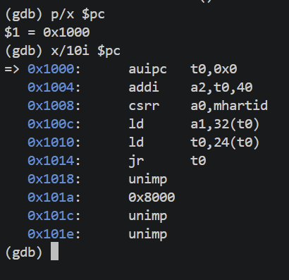
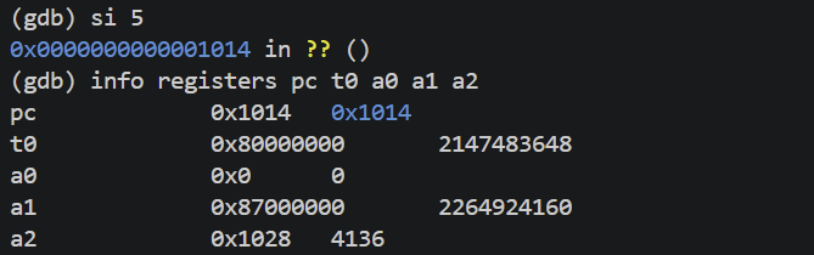
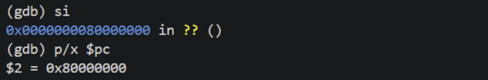
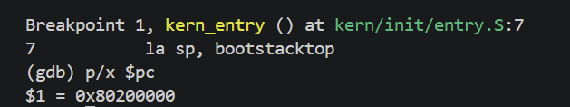
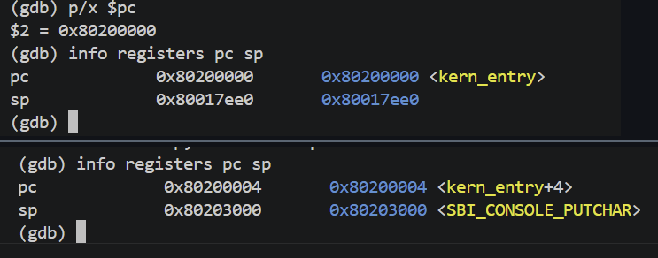
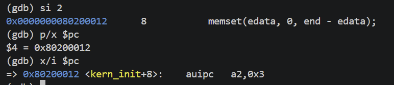
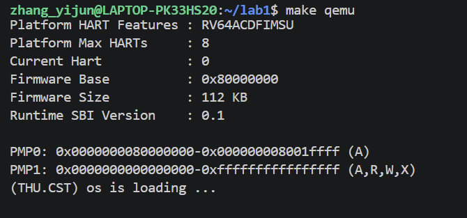

# 实验报告

## 实验基本信息

| **项目** | **内容** |
| :--- | :--- |
| **实验名称** | Lab 1: [最小可执行内核] |
| **小组成员** | 2511461-张壹钧、2512621-尹雯婕、2512752-韩硕 |
| **完成日期** | 2026-10-11 |

### 小组分工

练习分工：

| **成员** | **负责的练习/模块** |
| :--- | :--- |
| 2511461-张壹钧 | [练习一] |
| 2512621-尹雯婕 | [练习二] |
| 2512752-韩硕 | 内核初始化与输出模块分析：梳理 kern_init、cprintf、控制台接口及 SBI 服务的调用关系，核对内核运行输出 |

报告分工：

| **成员** | **负责的报告部分** |
| :--- | :--- |
| 2511461-张壹钧 | [实验基本信息、实验目的、实验环境、实验整体逻辑及练习一的撰写] |
| 2512621-尹雯婕 | [练习二的撰写] |
| 2512752-韩硕 | 核心模块分析、测试与验证、实验总结中公共知识点的整理 |

---

## 一、实验目的

本实验的主要目的是：

1. [目的1：搭建实验环境，熟悉Ubuntu Linux系统的常用命令，了解使用Qemu模拟器的方法]
2. [目的2：学习使用GBD、GNU make等方式调试代码，熟悉Qemu，GDB的各类调试命令]
3. [目的3：学习如何通过bootloader（在本实验中即OpenSBI）启动操作系统内核，以及如何通过调用SBI实现类似printf的函数cprintf]
4. [目的4：学习与AI协作完成实验环境的搭建、通过AI理解通过bootloader启动操作系统内核的过程]

---

## 二、实验环境

你们使用的 AI 工具

| **成员** | **AI 编程工具** | **底层模型** | **备注** |
| :--- | :--- | :--- | :--- |
| 2511461-张壹钧 | [ChatGPT（网页版）] | [GPT-6.1 sol] | [强度：中] |
| 2512621-尹雯婕 | | | |
| 2512752-韩硕 | | | |

**说明：**

- **AI 编程工具**：指具体使用的终端工具、编辑器插件、桌面应用或浏览器界面
- **底层模型**：指该工具使用的大语言模型及版本

---

## 三、实验整体逻辑分析

### 3.1 本章节的逻辑主线

本实验围绕“一个最小操作系统内核如何启动并完成输出”展开。普通应用程序通常由已有的操作系统加载和运行，而本实验中的内核需要在固件移交控制权后，自行建立运行 C 语言代码所需的基本条件，并通过底层服务实现控制台输出。

实验主要包含两条相互衔接的线索。第一条是内核启动流程：通过 Makefile 和链接脚本生成内核镜像，在 QEMU 中运行，观察处理器从复位代码进入 OpenSBI，再进入内核汇编入口 `kern_entry`，设置内核栈后跳转到 C 语言初始化函数 `kern_init`。第二条是内核输出流程：在 `kern_init` 中清零 BSS 区域，再通过 `cprintf` 发起格式化输出请求，将字符串逐步转换为字符，最终通过 SBI 接口请求 OpenSBI 完成输出。

因此，本实验需要理解的不只是启动提示能否显示，还包括内核镜像如何组织、控制权如何逐级移交、C 语言运行条件如何建立，以及内核如何使用固件提供的服务。练习一通过源码分析解释入口指令的作用，练习二通过 GDB 观察实际执行过程，运行验证则检查内核能否输出预期提示。这些内容共同构成了从构建、启动到输出的完整过程。

### 3.2 功能的逐步实现

本实验提供了最小内核的基础代码，各部分之间具有明确的依赖关系。我们按照以下顺序理解和验证这些功能。

1. **组织内核布局并生成镜像。**

   首先分析 Makefile 和 `tools/kernel.ld`。Makefile 组织编译、链接和镜像生成过程，链接脚本指定内核入口及代码段、数据段等区域的布局，将内核起始地址设为 `0x80200000`。编译链接后生成 `bin/kernel`，再转换为二进制镜像 `bin/ucore.img`。只有先得到布局正确的镜像，才能在模拟器中加载和执行内核。

2. **启动虚拟机并移交控制权。**

   QEMU 按启动配置将固件和内核镜像放入相应内存区域。处理器从复位地址 `0x1000` 开始执行启动代码，随后跳转到 `0x80000000` 处的 OpenSBI。OpenSBI 完成相应初始化后，将控制权移交给 `0x80200000` 处的内核入口。这一阶段为内核执行提供了基本的启动环境。

3. **设置内核栈并进入 C 语言函数。**

   内核首先执行 `kern/init/entry.S` 中的入口代码。`la sp, bootstacktop` 将栈指针设置为内核预留的栈顶地址，为后续函数调用提供栈空间；随后，`tail kern_init` 跳转到 C 语言初始化函数。设置栈必须先于需要使用栈的 C 语言代码执行，否则函数调用及局部数据保存无法获得可靠的基础。

4. **清零 BSS 区域并发起启动提示输出。**

   进入 `kern_init` 后，程序通过 `memset(edata, 0, end - edata)` 清零 BSS 区域，使未显式初始化的全局变量和静态变量具有零初值。随后调用 `cprintf` 输出启动提示。清零操作建立了初始化数据的基本状态，输出则提供了内核已经执行到这一阶段的可见标志。

5. **通过格式化模块和 SBI 服务完成输出。**

   `cprintf` 整理可变参数，`vcprintf` 调用 `vprintfmt` 解析格式字符串。解析得到的字符经 `cputch`、`cons_putc` 和 `sbi_console_putchar` 传递给 SBI 调用封装，再通过 `ecall` 请求 OpenSBI 完成字符输出。各层逐步连接格式化接口与底层服务，使内核能够显示完整的启动提示。

6. **结合调试和运行结果验证整个过程。**

   使用 GDB 观察关键地址、入口指令及栈指针变化，验证启动阶段之间的跳转；再通过实际运行检查终端是否显示 `(THU.CST) os is loading ...`。输出完成后，内核进入 `while (1)` 无限循环。源码分析、调试记录与运行结果相互对照，共同验证本实验最小内核的启动和输出流程。

---

## 四、实验内容与实现

---

### 练习：[练习一]

**负责人：** [2511461-张壹钧]

#### 问题一：指令 la sp, bootstacktop 完成了什么操作，目的是什么？

前置代码和汇编指令解析：\
在entry.S这个汇编文件中，有\
bootstack:\
.space KSTACKSIZE\
.global bootstacktop\
bootstacktop:\
其中，bootstack、bootstacktop均为标号，代表了两个地址，.space是汇编器指令，用于在汇编后链接前预留出一片KSTACKSIZE字节长的区域，KSTACKSIZE在memlayout.h和mmu.h两个头文件中宏定义，具体计算为内存栈的页数*页大小(2*4096=8192)。.global也是汇编器指令，它把符号 bootstacktop 声明成一个全局符号，让链接器和其他目标文件能够看到这个标号。这一段代码在内存上划分了一片大小8192字节的栈区域供内核使用，并把栈顶地址存在bootstacktop这一全局标号中。

指令la是一个伪指令，即"load address"的缩写，具体操作是读取右操作数的地址，并把读取到的地址存在左操作数里。 la sp, bootstacktop就是将刚刚划分的栈的栈顶地址加载给sp栈指针寄存器。\
该操作的目的是：\
未执行这一指令前，栈指针寄存器中保存的仍是上一启动阶段留下来的值（固件OpenSBI使用的栈区域），而未来进入操作系统内核，不再使用汇编语言后，C语言编写的函数工作通常就都需要栈了，例如函数可能要保存返回地址等等。这时就需要提供一片内核能够直接控制的栈区域。由于栈是由高地址到低地址的，这时我们让sp栈指针指向bootstacktop所存的地址，那么从bootstack标号对应的地址到bootstacktop标号对应地址之间提前预留好的区域，便可作为内核可操控的栈区域使用了。

#### 问题二：指令 tail kern_init 完成了什么操作，目的是什么？

指令及调用的对应函数解析：
指令tail是一个伪指令，即尾调用（AI给出的名词），通常意义上的call需要在寄存器ra中保留一个返回的地址，而尾调用不保留返回地址，PC只jump过去，不再回到entry.S；kern_init 是定义在init.c中的函数，在本次实验中kern_init中调用了用户自己编写的"memset"，用于清除bss数据段，还调用了我们通过SBI调用编写的cprintf函数，输出(THU.CST) os is loading ...字样，最终进入死循环
该操作的目的是：
在la sp，bootstacktop指令后，计算机完成了对操作系统内核栈的初始化，准备将操作权转让给操作系统内核；kern_init正是操作系统内核的入口点，这里操作系统与用户第一次进行交互，输出了os is loading的字样，未来的功能都由这里开始继续实现。

-------------------------------------------------------------------------------------------------------------------------------------

### 练习：[练习二]

**负责人：** [2512621-尹雯婕]

#### 1. 调试目标与方法

本练习使用 QEMU 和 GDB 跟踪 RISC-V 虚拟机从复位到进入内核的过程，通过单步执行、查看程序计数器 PC 和寄存器，观察 QEMU 启动代码、OpenSBI、内核汇编入口和 C 语言初始化函数之间的执行顺序。

调试中主要使用以下 GDB 命令：

| 命令 | 作用 |
| :--- | :--- |
| `si` | 执行一条机器指令 |
| `p/x $pc` | 以十六进制查看当前 PC |
| `x/i $pc` | 查看当前 PC 指向的指令 |
| `info registers` | 查看寄存器状态 |
| `p/x $sp` | 查看栈指针 |
| `break kern_entry` | 在内核入口设置断点 |
| `continue` | 继续执行，直到遇到断点或其他停止条件 |

#### 2. 观察 QEMU 复位后的执行位置

GDB 连接到 QEMU 后，观察到初始 PC 为 `0x1000`。这说明处理器首先执行的是 QEMU 提供的启动代码，此时尚未进入实验内核。



继续单步执行到 `0x1014` 时，观察到以下寄存器值：

| 寄存器 | 观察值 |
| :--- | :--- |
| `t0` | `0x80000000` |
| `a0` | `0` |
| `a1` | `0x87000000` |
| `a2` | `0x1028` |

其中，`t0` 保存随后要跳转到的目标地址，`a0=0` 对应当前 hart 编号。在本次启动过程中，`a1` 保存传递给后续启动阶段的设备树地址；`a2` 的值在此处作为寄存器观察结果记录。



执行 `jr t0` 后，PC 变为 `0x80000000`。由于 `t0` 中保存的正是这个地址，因此该指令将控制权转移到了 OpenSBI 的执行区域，验证了从 QEMU 启动代码进入固件的过程。



#### 3. 验证进入内核入口 kern_entry

调试时明确指定 `-kernel bin/ucore.img`，并在 `kern_entry` 设置断点。断点命中时，观察到 PC 为 `0x80200000`，说明启动流程已经从 OpenSBI 进入实验内核的汇编入口。

这里的两个地址对应不同启动阶段：`0x80000000` 对应本次运行中的 OpenSBI 执行区域，`0x80200000` 对应实验内核的入口。到达后一个地址，表明处理器开始执行内核入口代码。



#### 4. 观察内核栈指针的变化

在内核入口处单步执行，观察到栈指针发生以下变化：

| 状态 | sp 的值 |
| :--- | :--- |
| 执行设置栈指针的指令前 | `0x80017ee0` |
| 执行后 | `0x80203000` |

这一变化对应练习一中的 `la sp, bootstacktop`，即将内核预留的栈顶地址加载到栈指针寄存器中。

栈指针切换后，内核可以在自己的栈区域中保存函数调用所需的数据，为随后运行 C 语言函数做准备。实际观察到的 `sp` 变化，验证了练习一对该指令作用的分析。



#### 5. 验证进入 kern_init

继续单步执行后，观察到 PC 为 `0x80200012`，GDB 将该地址显示为 `kern_init+8`。该符号信息表明程序已经进入 `kern_init`，完成了从汇编入口到 C 语言初始化函数的转移。

此时 GDB 显示的源码位置与 `memset(edata, 0, end - edata)` 所在行相关，对应内核初始化中清零 BSS 区域的操作。当前的 PC 和符号位置能够证明已经进入 `kern_init`，但不单独证明该函数中的全部初始化操作已经执行完毕。



#### 6. 调试中遇到的问题与处理

最初使用 `make debug` 调试时，没有命中预期的内核断点，并记录到以下异常相关寄存器值：

| 寄存器 | 观察值 |
| :--- | :--- |
| `mcause` | `1` |
| `mepc` | `0` |
| `mtval` | `0` |

`mcause=1` 表示指令访问异常。这些寄存器值说明该次运行发生了异常，没有正常到达预期的内核入口；仅凭这些信息不能断定唯一原因。

随后明确指定 `-kernel bin/ucore.img` 并重新设置断点，成功在 `0x80200000` 命中 `kern_entry`，完成了后续验证。此次调试使我们认识到，排查断点未命中的问题时，需要同时检查 QEMU 的启动参数、内核镜像加载方式和 GDB 的断点位置。

#### 7. 练习结论

本次调试观察到的执行顺序为：

QEMU 启动代码（`0x1000`）→ OpenSBI（`0x80000000`）→ 内核入口 `kern_entry`（`0x80200000`）→ `kern_init`。

其中，`sp` 从 `0x80017ee0` 变为 `0x80203000`，验证了内核栈的设置；PC 到达 `kern_init+8`，验证了从汇编入口进入 C 语言初始化函数的过程。因此，练习二通过实际调试，为练习一对 `la sp, bootstacktop` 和 `tail kern_init` 的分析提供了运行证据。

---

说明：由于本次实验不涉及代码编写及功能实现，故实验内容中没有模块代码及模块实现的内容

### 核心模块分析：内核初始化与输出

**负责人：** [2512752-韩硕]

#### 1. 内核初始化函数 kern_init

`kern/init/init.c` 中的 `kern_init` 是内核的 C 语言初始化函数。从汇编入口跳转到该函数后，程序依次完成 BSS 区域清零、输出启动提示和进入无限循环三个步骤。

首先，函数通过 `extern char edata[], end[]` 引用链接脚本定义的两个地址符号。在 `tools/kernel.ld` 中，`edata` 位于已初始化数据段之后，`end` 位于 BSS 段之后。因此，`memset(edata, 0, end - edata)` 将这两个地址之间的区域清零，使 BSS 中未显式初始化的全局变量和静态变量具有规定的零初值。这里的 `end - edata` 表示待清零区域的字节数。

随后，函数将启动提示保存到字符串 `message` 中，并执行 `cprintf("%s\n\n", message)`。其中，`%s` 表示输出参数指向的字符串，预期显示的文字为 `(THU.CST) os is loading ...`。该输出为观察内核执行情况提供了一个直观标志，其具体实现依赖后续的格式解析、控制台封装和 SBI 服务调用。

最后，函数执行 `while (1)` 空循环，使程序持续运行而不返回。函数声明中的 `__attribute__((noreturn))` 告知编译器该函数不会正常返回，实际保证这一行为的是末尾的无限循环。因此，启动提示输出后不再出现新内容，符合本实验最小内核的设计。

#### 2. 格式化输出接口 cprintf 与 vcprintf

`kern/libs/stdio.c` 中的 `cprintf` 是内核提供的格式化输出接口，其参数包括格式字符串和数量可变的其他参数。例如，`cprintf("%s\n\n", message)` 中，格式字符串决定输出形式，`message` 提供需要输出的字符串内容。

`cprintf` 的实现如下：

```c
int cprintf(const char *fmt, ...) {
    va_list ap;
    int cnt;
    va_start(ap, fmt);
    cnt = vcprintf(fmt, ap);
    va_end(ap);
    return cnt;
}
```

其中，`va_list ap` 用于访问可变参数，`va_start(ap, fmt)` 初始化参数列表。随后，函数将格式字符串 `fmt` 和参数列表 `ap` 传给 `vcprintf`，处理完成后通过 `va_end(ap)` 结束参数列表的使用，并返回字符计数。

`vcprintf` 的实现如下：

```c
int vcprintf(const char *fmt, va_list ap) {
    int cnt = 0;
    vprintfmt((void *)cputch, &cnt, fmt, ap);
    return cnt;
}
```

该函数首先将计数器 `cnt` 初始化为零，再调用 `vprintfmt` 进行格式解析。传入的 `cputch` 是字符输出回调，`&cnt` 是计数器地址。格式解析模块每生成一个字符，就通过回调将其送入输出接口，并更新计数器。

因此，这两层函数的分工是：`cprintf` 负责整理可变参数，`vcprintf` 负责组织格式解析、字符输出和计数。具体的格式解析由 `vprintfmt` 完成，底层字符输出则由后续的控制台和 SBI 接口完成。

#### 3. 格式解析模块 vprintfmt

`libs/printfmt.c` 中的 `vprintfmt` 负责解析格式字符串，并将需要输出的内容转换为单个字符。该函数接收字符输出回调 `putch`、回调所需的数据 `putdat`、格式字符串 `fmt` 和可变参数列表 `ap`。

函数逐字符读取格式字符串。遇到普通字符时，直接调用 `putch(ch, putdat)` 输出；遇到 `%` 时，根据后续字符进入对应的格式处理分支。例如，`%s` 对应字符串，`%d` 对应有符号十进制整数，`%x` 对应十六进制数。

在本次启动提示中，格式字符串为 `"%s\n\n"`。函数进入 `case 's'` 分支，通过 `va_arg(ap, char *)` 取得 `message` 指向的字符串，再依次读取其中的字符，并通过回调输出，直到遇到字符串结束符 `\0`。随后，函数继续处理格式字符串中的两个换行符。

因此，`vprintfmt` 的主要作用是确定“需要输出哪些字符”，具体将字符送往控制台的工作由传入的回调完成。这种设计将格式解析与实际输出分开，使同一套格式解析逻辑能够配合不同的字符处理接口使用。

#### 4. 字符输出回调与控制台接口

`kern/libs/stdio.c` 中的 `cputch` 是传给格式解析模块的字符输出回调，其实现如下：

```c
static void cputch(int c, int *cnt) {
    cons_putc(c);
    (*cnt)++;
}
```

该函数每次接收一个字符，调用 `cons_putc` 将其送入控制台输出接口，并将计数器加一。计数器地址由 `vcprintf` 传入，因此各次回调更新的是同一个计数器，最终得到本次格式化输出的字符数量。

`kern/driver/console.c` 中的 `cons_putc` 实现如下：

```c
void cons_putc(int c) {
    sbi_console_putchar((unsigned char)c);
}
```

该函数将字符转换为 `unsigned char`，再调用 `sbi_console_putchar`。上层格式解析模块通过统一的控制台接口输出字符，不需要直接处理底层设备访问。

本实验中的 `cons_init`、`kbd_intr` 和 `serial_intr` 仍为空实现，字符输出依靠 OpenSBI 提供的服务完成。因此，当前代码建立了可用的控制台输出路径，但尚未实现完整的内核设备初始化及中断驱动输入输出。

#### 5. SBI 服务调用与 ecall 指令

`libs/sbi.c` 中的 `sbi_console_putchar` 将字符输出请求交给通用函数 `sbi_call`：

```c
void sbi_console_putchar(unsigned char ch) {
    sbi_call(SBI_CONSOLE_PUTCHAR, ch, 0, 0);
}
```

本份源码将 `SBI_CONSOLE_PUTCHAR` 定义为 `1`，对应传统 SBI 接口中的控制台字符输出服务。调用时，第一个参数指定服务编号，第二个参数传递待输出字符，其余两个参数设置为零。

`sbi_call` 使用内联汇编，将服务编号和参数放入约定的寄存器，再执行 `ecall`。本次调用中的寄存器设置如下：

| 寄存器 | 传入内容 | 作用 |
| :--- | :--- | :--- |
| `a7`，即 `x17` | `1` | 指定传统 SBI 控制台字符输出服务 |
| `a0`，即 `x10` | 字符 `ch` | 传递待输出字符 |
| `a1`，即 `x11` | `0` | 对应封装中的第二个服务参数 |
| `a2`，即 `x12` | `0` | 对应封装中的第三个服务参数 |

内核在 S 模式下执行 `ecall`，触发异常并进入 M 模式下的 OpenSBI 服务处理过程。OpenSBI 根据服务编号处理字符输出请求，完成后返回内核，内核继续执行后续代码。

这里的调用与普通 C 函数调用不同。普通函数调用在当前执行环境中跳转到目标函数，而 SBI 调用需要通过规定的寄存器传参，并使用 `ecall` 请求更高特权级的固件服务。这也不同于用户程序向操作系统发起系统调用：本实验中的请求方是内核，服务提供方是 OpenSBI 固件。

`sbi_call` 在 `ecall` 返回后，将 `a0` 的值移入 C 变量并返回。不过，本次 `sbi_console_putchar` 不使用该返回值，而是在字符输出请求处理完成后结束调用。

#### 6. 输出模块的整体关系

通过核对源码，可以将启动提示的输出过程分为以下层次：

| 层次 | 关键函数 | 主要职责 |
| :--- | :--- | :--- |
| 内核初始化 | `kern_init` | 清零 BSS，发起启动提示输出 |
| 格式化输出接口 | `cprintf`、`vcprintf` | 整理可变参数，组织输出并统计字符数量 |
| 格式解析 | `vprintfmt` | 解析格式字符串，将内容转换为字符 |
| 字符输出回调 | `cputch` | 调用控制台接口并增加字符计数 |
| 控制台封装 | `cons_putc` | 将字符交给 SBI 字符输出函数 |
| SBI 调用封装 | `sbi_console_putchar`、`sbi_call` | 设置服务编号和参数，执行 `ecall` |
| 固件服务 | OpenSBI | 处理控制台输出请求 |

启动提示能够显示，是这些模块共同工作的结果。`kern_init` 提供需要输出的内容，格式化模块解析内容，控制台接口传递字符，SBI 封装最终请求固件完成输出。各层通过明确的函数接口连接，构成了本实验最小内核的基本输出功能。

上述函数关系通过源码阅读核对；实际启动提示的显示结果则用于验证这条输出路径在本次字符串输出场景中能够正常工作。

---

## 五、测试与验证

**负责人：** [2512752-韩硕]

### 5.1 测试目的

验证最小内核能否在 QEMU 中正常启动，并通过格式化输出模块和 SBI 控制台服务显示预期的启动提示。同时，将运行结果与源码分析进行对照，检查内核输出内容及输出后的运行行为是否符合设计。

### 5.2 测试过程

进入包含 Makefile 的 `lab1` 目录，在终端执行以下命令：

```bash
make qemu
```

该命令按照 Makefile 中的依赖关系完成所需的构建步骤，并启动 QEMU 运行内核。启动后，在终端观察固件信息和内核输出，记录运行结果并保存截图。

### 5.3 预期结果与实际结果

根据 `kern/init/init.c` 中的代码，内核进入 `kern_init` 后，应先清零 BSS 区域，再调用 `cprintf` 输出以下启动提示，最后进入无限循环：

```text
(THU.CST) os is loading ...
```

本次执行 `make qemu` 后，终端显示了 OpenSBI 的相关信息及上述启动提示，输出文字与源码中的 `message` 字符串一致。提示输出后，程序保持运行，没有继续产生新的输出，与 `kern_init` 末尾的 `while (1)` 空循环相符。

| 验证项目 | 验证依据 | 验证结果 |
| :--- | :--- | :--- |
| 内核启动 | 终端显示由 `kern_init` 发起的启动提示 | 内核已执行到启动提示输出阶段 |
| 字符串格式化输出 | `%s` 对应的字符串正确显示 | 本次字符串输出符合预期 |
| 控制台与 SBI 输出路径 | 源码调用关系与终端输出结果相互对应 | 本次字符输出路径能够正常工作 |
| 输出后的运行行为 | 提示输出后不再产生新内容，程序保持运行 | 与源码中的无限循环设计相符 |

### 5.4 验证结果分析

本次运行结果与输出模块的源码分析一致。`kern_init` 发起输出请求，`cprintf` 和 `vcprintf` 整理参数并组织输出，`vprintfmt` 解析格式字符串，生成的字符经过 `cputch`、`cons_putc` 和 SBI 调用封装，最终由 OpenSBI 服务完成输出。启动提示能够正确显示，说明这些模块在本次字符串输出场景中可以正常协作。

练习二通过 GDB 观察了启动代码进入内核入口、设置内核栈及跳转到 `kern_init` 的过程。本部分进一步通过 `make qemu` 验证了内核能够完成可见的启动提示输出，两部分共同支持最小内核的启动与输出目标。

本次运行验证主要覆盖启动程序使用的字符串输出路径。BSS 清零的范围和作用通过源码分析理解，未进行逐字节的动态检查；其他格式符也未逐项测试。

**测试截图：**



图：执行 `make qemu` 后，终端显示 OpenSBI 相关信息及 `(THU.CST) os is loading ...`，验证了内核能够启动并输出预期提示。

---

## 六、实验总结与收获

### 6.1 对操作系统的理解

#### 6.1.1 本实验的重要知识点及其与操作系统原理的关系

通过源码阅读、GDB 调试和 QEMU 运行验证，我们理解了最小内核从启动到完成输出的基本过程。实验涉及的主要知识点及其与操作系统原理的关系如下。

| 重要知识点 | 本实验中的体现 | 与操作系统原理的联系及差异 |
| :--- | :--- | :--- |
| 内核启动与控制权移交 | 处理器从 `0x1000` 开始执行启动代码，随后进入 OpenSBI，再跳转到 `0x80200000` 处的内核入口 | 操作系统原理中的启动过程关注固件、引导程序与内核之间的衔接。本实验展示了这一基本过程，但采用 QEMU 和 OpenSBI 提供的启动环境，尚未涉及真实计算机中完整的硬件自检、磁盘引导和内核加载流程 |
| 内核布局与链接 | 链接脚本指定入口 `kern_entry`，组织代码段、只读数据段、数据段及 BSS 段，并定义相关地址符号 | 这一过程体现了程序运行前需要确定代码和数据布局的要求。本实验主要关注静态布局和链接地址，还没有实现操作系统运行期间的动态内存分配及虚拟地址映射 |
| 内核栈与函数调用 | `la sp, bootstacktop` 将栈指针设置为内核预留的栈顶地址，为后续 C 语言函数执行提供条件 | 栈用于保存函数调用过程中的返回地址、局部变量及需要保存的寄存器等信息，是内核执行的基础。本实验只设置了启动阶段使用的内核栈，尚未涉及多个进程的独立内核栈和上下文切换 |
| BSS 区域初始化 | `kern_init` 通过 `memset(edata, 0, end - edata)` 清零 BSS 区域 | 该操作保证未显式初始化的全局变量和静态变量具有零初值，说明内核需要自行建立基本运行条件。它属于启动初始化，不等同于完整的内存管理，也不是清空全部内存 |
| 特权级与 SBI 调用 | 内核在 S 模式下通过 `ecall` 请求 M 模式中的 OpenSBI 服务 | 操作系统原理中的特权级机制用于限制资源访问，并通过规定的入口提供服务。本实验体现了内核与固件之间的服务调用；它与用户程序向内核发起系统调用具有相似的受控调用思想，但请求方、服务提供方及所处特权级不同 |
| 输出接口与模块分层 | 输出请求依次经过格式化接口、格式解析、字符输出回调、控制台接口和 SBI 封装 | 这一结构体现了模块分工和接口抽象：上层决定输出内容，下层完成字符传递及底层服务调用。本实验借助 OpenSBI 完成输出，尚未由内核独立实现完整的设备驱动和中断处理 |

本实验使我们认识到，内核的运行依赖多个基础环节相互配合。启动代码负责移交控制权，汇编入口建立内核栈，初始化函数设置基本数据状态，输出模块再通过固件服务完成可见输出。终端中的一行启动提示，实际反映了这些环节已经在当前运行场景中协同工作。

同时，源码分析与运行验证能够相互补充。源码用于解释各模块为什么这样设计，GDB 用于观察关键指令和寄存器的实际变化，QEMU 运行结果则用于检查最终输出。将三者结合，可以更清楚地理解内核启动过程，而不是仅凭输出结果推测全部功能都已正确实现。

#### 6.1.2 操作系统原理中重要但本实验尚未涉及的知识点

本实验构建的是最小可执行内核，主要覆盖启动、基本初始化和控制台输出。以下重要内容尚未在本实验中实现：

1. **进程与线程管理。** 本实验没有创建用户进程，也没有实现进程状态管理、调度及上下文切换。内核输出提示后直接进入无限循环，尚不具备多任务运行能力。

2. **虚拟内存与内存保护。** 本实验尚未建立页表、启用分页或处理缺页异常，也没有通过地址空间隔离保护不同进程的内存。链接脚本中的静态布局与运行时的虚拟内存管理属于不同环节。

3. **完整的中断、异常处理和设备驱动。** 本实验通过 SBI 调用使用固件提供的字符输出服务，但尚未建立完整的内核中断处理机制，也未实现基于设备中断的输入输出管理。

4. **用户态与系统调用。** 本实验没有运行用户程序，因此尚未实现用户态进入内核态的系统调用接口。当前的 SBI 调用发生在内核与固件之间，不能直接视为用户程序的系统调用。

5. **文件系统与持久化存储。** 本实验没有涉及文件和目录管理、磁盘读写及数据持久化，内核也尚未提供文件访问接口。

6. **同步与互斥。** 本实验没有多个任务并发访问共享资源，因此尚未涉及锁、信号量、竞态条件和死锁等问题。

通过本实验，我们掌握了理解后续内核功能所需的启动与输出基础，也认识到一个能够启动的内核距离完整操作系统仍有较大差距。后续需要进一步建立异常处理、内存管理和进程管理等机制，逐步形成能够管理资源并运行用户程序的操作系统。

### AI 协作开发的经验

[写出你们在与 AI 协作过程中实际收获的经验或者感悟]

---