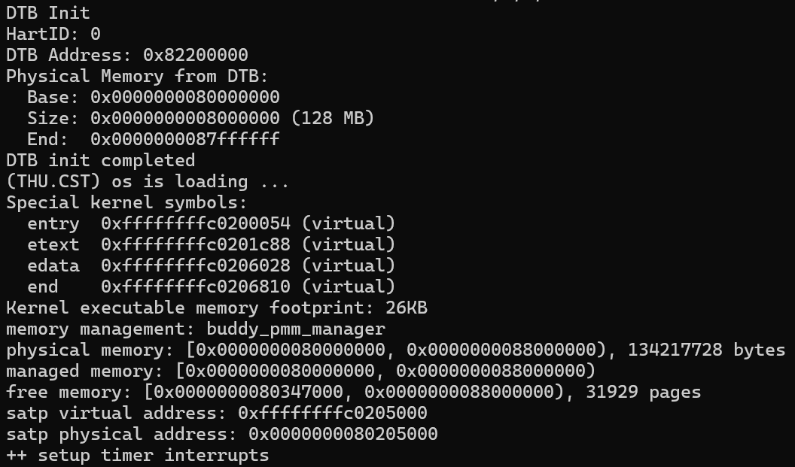
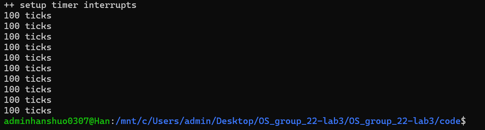
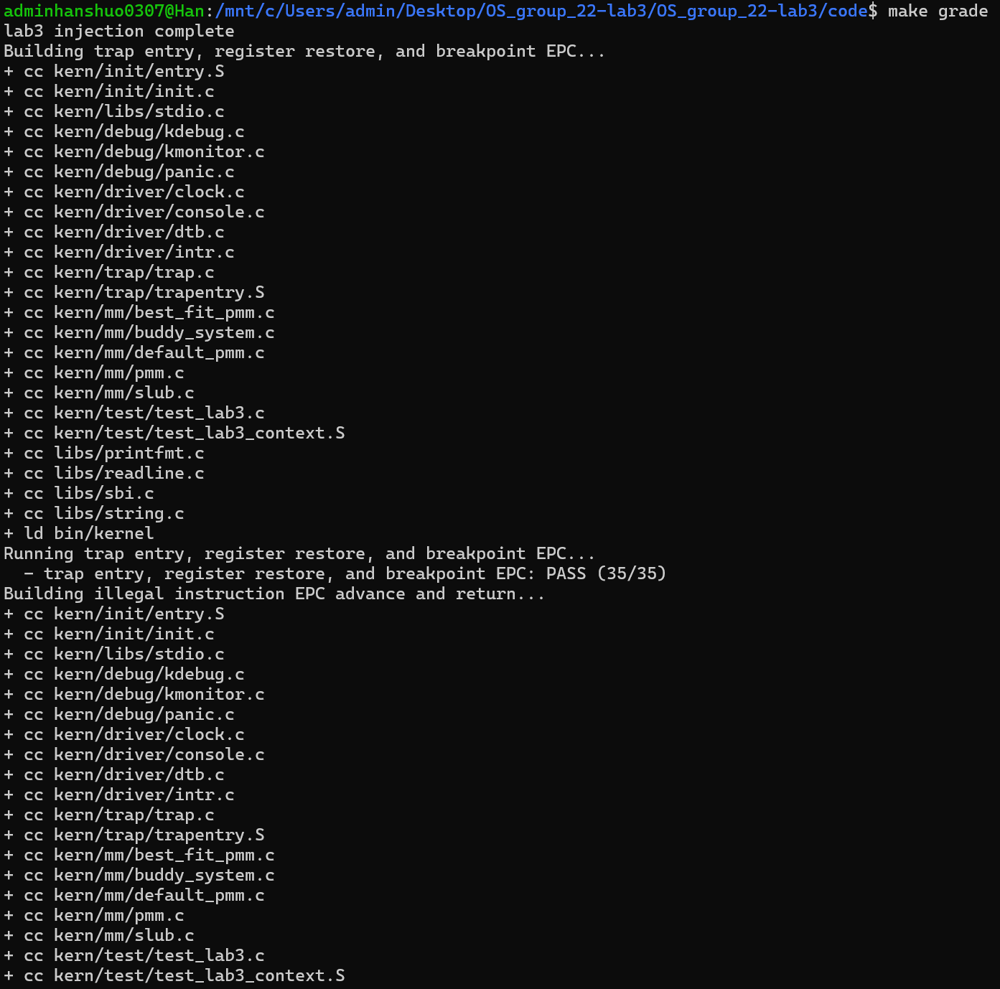
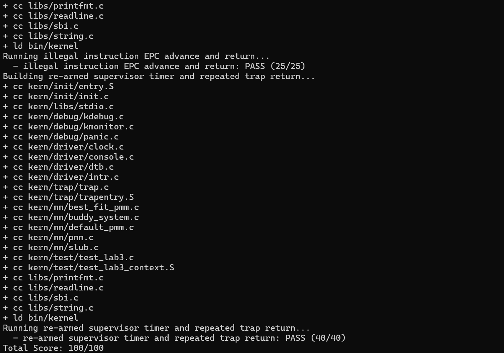

# 实验报告

## 实验基本信息

| 项目 | 内容 |
|------|------|
| **实验名称** | Lab 3: 中断及异常处理 |
| **小组成员** | 2512752-韩硕、2511461-张壹钧、2512621-尹雯婕|
| **完成日期** | 2026-10-30 |

### 小组分工

练习分工：

| 成员 | 负责的练习/模块 |
|------|----------------|
| 2512752-韩硕 | 功能模块一：补全 `RESTORE_ALL` 和 `__alltraps`，实现上下文恢复、调用 `trap()` 及 Trap 返回衔接；分析 Trap frame 与栈布局，验证寄存器恢复。 |
| 2511461-张壹钧 | [整理lab2代码，将分配算法对应的测试模块进行精简，同时补全功能模块二中的 `exception_handler` ] |
| 2512621-尹雯婕 | 补全 `interrupt_handler`，实现中断分类、时钟事件重设及 `ticks` 计数；每累计 100 次时钟中断输出一次，第 10 次输出后关机；补充其他已知中断的类型提示与未知中断的原因号及现场打印，保持原始现场不变 |

报告分工：

| 成员 | 负责的报告部分 |
|---|---|
| 2512752-韩硕 | Trap 入口与上下文恢复部分：说明 `SAVE_ALL`、`RESTORE_ALL`、`__alltraps` 和 `sret` 的作用，分析寄存器保存位置及栈变化；整理本模块的 spec、prompt、实际问题及解决过程，并记录相关测试结果。 |
| 2511461-张壹钧 | 异常处理与 Lab2 代码衔接部分：说明异常分类、指令长度判断、返回地址更新及补全内容；整理本模块的 spec、prompt、实际问题及解决过程，并记录相关测试结果。 |
| 2512621-尹雯婕 | 中断与时钟部分：说明初始化、中断使能、时钟重设、计数和同步保护；整理本模块的 spec、prompt、实际问题及解决过程，汇总整体测试结果 |
| 三人共同 | 整理实验整体流程、实验知识点与 OS 原理的联系，以及本实验未涉及的重要知识点；检查报告、代码和图片是否完整，并完成提交。 |
---

## 一、实验目的

本实验的主要目的是：

1. 理解 RISC-V 的中断与异常处理机制，了解相关寄存器的作用及 Trap 的完整处理流程。
2. 掌握通过 Trap frame 保存和恢复上下文的方法，实现汇编入口与 C 语言处理函数的衔接，使程序在处理结束后能够继续执行。
3. 实现断点、非法指令等异常的处理，理解返回地址更新与指令长度之间的关系。
4. 实现时钟中断的设置、计数与持续触发，了解中断使能和关闭中断保护临界区的作用。
5. 学习根据实验要求编写 spec 和 prompt，借助 AI 完成代码，并通过代码检查与运行测试验证实现。

---

## 二、实验环境

你们使用的 AI 工具

| 成员 | AI 编程工具 | 底层模型 | 备注 |
|------|------------|---------|------|
| 2512752-韩硕 | ChatGPT网页版| GPT-6.1 sol |  |
| 2511461-张壹钧 | Codex vscode插件|GPT-6.1 sol | 推理强度：高|
| 2512621-尹雯婕 | ChatGPT网页版 | GPT-6.1 sol| |

**说明：**
- **AI 编程工具**：指具体使用的终端工具、编辑器插件、桌面应用或浏览器界面
- **底层模型**：指该工具使用的大语言模型及版本

---

## 三、实验整体逻辑分析

### 3.1 本章节的逻辑主线

本实验围绕中断与异常处理展开。在 Lab2 内存管理的基础上，让内核能够在发生 Trap 时保存当前现场，进入 C 语言处理函数，完成处理后恢复现场并继续执行。

核心流程为：发生中断或异常 → 进入 `__alltraps` → 保存现场 → 调用 `trap()` → 分发并处理 → 恢复现场 → 执行 `sret` 返回。

其中，汇编代码负责保存和恢复寄存器，C 代码负责判断原因并进行具体处理，两者通过 `trapframe` 传递现场信息。

### 3.2 功能的逐步实现

1. **补全 Lab2 代码，准备运行基础。**  
   将已完成的 Lab2 缺失代码补入本次框架，使内核具备正常启动和物理内存管理的基础。

2. **完成 Trap 入口与上下文恢复。**  
   利用已有的 `SAVE_ALL` 保存现场，补全 `RESTORE_ALL`，按照 `trapframe` 的布局恢复寄存器，并将 `sp` 放到最后恢复。这是异常和中断处理结束后能够正确返回的基础。

3. **连接汇编入口与 C 处理函数。**  
   在 `__alltraps` 中，将当前 `trapframe` 的地址放入 `a0`，调用 `trap()`。C 处理函数返回后，继续执行 `RESTORE_ALL` 和 `sret`，形成完整的进入与返回流程。

4. **实现具体的异常和中断处理。**  
   异常处理根据原因识别非法指令、断点等情况，并按照指令长度更新返回地址，避免重复触发同一异常。中断处理完成类型区分，时钟中断还需要重设下一次事件、累计次数、输出统计信息，并在达到规定条件后关机。

5. **完成初始化并进行联合验证。**  
   通过 `idt_init()` 设置 Trap 入口，通过 `clock_init()` 准备时钟中断，最后由 `intr_enable()` 开启中断。合并各模块后，检查断点和非法指令处理后能否继续执行、寄存器是否正确恢复，以及时钟中断能否持续发生并按要求关机。


---

## 四、实验内容与实现

### 功能模块一：Trap 上下文恢复与入口调用

**负责人：2512752-韩硕**

#### 模块功能描述

**需要实现/修改的内容：**

本模块修改 `kern/trap/trapentry.S` 中的两处指定位置：

| 修改位置 | 实现内容 |
|---|---|
| `RESTORE_ALL` 宏 | 从栈上的 Trap frame 中恢复状态、返回地址和通用寄存器，最后恢复原来的栈指针。 |
| `__alltraps` 入口 | 将 Trap frame 的地址作为参数传入 C 函数 `trap()`，并在函数返回后衔接现场恢复。 |

调用的 C 函数接口为：

```c
void trap(struct trapframe *tf);
```

**功能说明：**

发生中断或异常后，CPU 进入 `__alltraps`，由已有的 `SAVE_ALL` 将现场保存到栈中。本模块将保存的现场交给 `trap()`，由异常或中断处理函数完成具体处理，再恢复寄存器并通过 `sret` 返回。

本模块负责入口和返回过程，具体异常处理由成员 B 完成，中断和时钟处理由成员 C 完成。

#### 需求规格（spec）

1. 保存和恢复必须使用相同的 Trap frame 布局。RV64 下每个槽位占 8 字节，整个结构共 36 个槽位，占 288 字节。
2. 从第 32、33 个槽位取出保存的 `sstatus` 和 `sepc`，写回对应 CSR；恢复通用寄存器时，跳过恒为零的 `x0`，将 `x2/sp` 放在最后恢复。
3. 将当前 `sp` 指向的 Trap frame 地址放入 `a0`，按照 RISC-V 调用约定调用 `trap()`。
4. 使用已有的 `__trapret` 和 `sret` 完成返回，不在汇编入口中自行调整异常指令的返回地址。
5. 只补全指定位置，不修改已有的 `SAVE_ALL`、`trapframe` 布局和 `trap()` 函数签名。

#### 最终提示词

```text
任务说明
请在提供的 Lab3 工程中完成“Trap 上下文恢复与入口调用”这一完整功能，使内核能够在保存现场后进入 C 语言处理函数，并在处理结束后恢复现场、返回原执行流。
只补全 kern/trap/trapentry.S 中标注“lab3 function1 YOUR CODE”的两处：
1. RESTORE_ALL 宏。
2. __alltraps 中 SAVE_ALL 之后的入口调用部分。
如果两处已有实现，先按下述要求检查；正确部分保留，只修正实际问题，不重复插入代码。保留已有的说明性注释。
不要修改其他成员负责的异常、中断处理或 Lab2 代码，不修改 SAVE_ALL、头文件、Makefile 和测试文件。
完成后给出实际修改的代码片段、对应位置、恢复顺序说明及真实验证结果。

上下文信息
请先阅读以下真实工程文件，以已有定义为准：
- kern/trap/trapentry.S
- kern/trap/trap.h
- kern/trap/trap.c
- libs/riscv.h
当前为 RV64 环境。libs/riscv.h 已定义：
- REGBYTES 为 8。
- STORE 对应 sd。
- LOAD 对应 ld。
trap.h 中，struct pushregs 按 x0～x31 的编号顺序排列，使用对应的寄存器别名作为字段名。每个字段为 uintptr_t，占 8 字节。
完整现场结构为：
struct trapframe {
    struct pushregs gpr;
    uintptr_t status;
    uintptr_t epc;
    uintptr_t badvaddr;
    uintptr_t cause;
};
因此，栈上现场的布局为：
- 第 0～31 个槽位：x0～x31，各槽位偏移为寄存器编号乘 REGBYTES。
- 第 32 个槽位：sstatus，字节偏移 256。
- 第 33 个槽位：sepc，字节偏移 264。
- 第 34 个槽位：sbadaddr，字节偏移 272。
- 第 35 个槽位：scause，字节偏移 280。
- 总大小为 36 × REGBYTES，即 288 字节。
已有 SAVE_ALL 的关键行为：
1. 将进入 Trap 时的原 sp 暂存到 sscratch。
2. 将 sp 减去 288，为现场分配栈空间。
3. 保存通用寄存器，x2/sp 单独处理。
4. 通过临时寄存器读取原 sp 和四个 CSR，再写入对应槽位。
5. 原 sp 最终保存在第 2 个槽位，即当前 sp + 16。
6. SAVE_ALL 结束时，当前 sp 指向完整 trapframe，sscratch 已清零。
注意：
- x1 与 ra 是同一个寄存器。
- x2 与 sp 是同一个寄存器。
- x8、x9 分别是 s0、s1。
- 通用寄存器原值和 CSR 保存值是不同的数据，不能混淆槽位。
C 处理入口已经声明：
void trap(struct trapframe *tf);
按照 RISC-V 调用约定，第一个参数通过 a0 传递。正常 C 函数返回时，sp 应恢复到调用前的值；调用者保存寄存器可能被处理函数改变。
文件末尾已有：
__trapret:
    RESTORE_ALL
    sret
当前任务以框架已有的内核态 Trap 处理为范围，不扩展用户栈切换、进程切换或浮点寄存器保存。

接口清单
本模块交付以下两个汇编功能，名称和既有调用关系保持不变：
1. RESTORE_ALL
   输入：sp 指向有效的 struct trapframe。
   输出：恢复该现场中保存的整数通用寄存器、sstatus 和 sepc，并恢复保存的 sp。
   该宏本身不完成最终跳转，返回由后面已有的 sret 完成。
2. __alltraps
   入口处继续使用已有 SAVE_ALL。
   保存完成后，将当前 trapframe 的地址作为参数调用 trap(struct trapframe *tf)。
   trap() 正常返回后，执行已有 __trapret 中的恢复与返回流程。
保持以下内容不变：
- SAVE_ALL 的实现。
- struct pushregs 和 struct trapframe 的布局。
- trap() 的函数签名。
- __alltraps、__trapret 的全局符号和入口对齐。
- 已有的最终 sret 指令。
- 工程中其他模块的实现和测试。

行为规范
1. 入口传参
   trap() 收到的指针必须等于 SAVE_ALL 结束时的 sp，直接指向原有栈上现场，不另外复制或创建 trapframe。
2. 函数调用与返回
   必须建立正确的 C 函数调用和返回关系，不能使用只跳转、不记录返回地址的方式代替调用。
   trap() 返回后，sp 仍应指向原现场，并继续执行 __trapret，不能绕过恢复过程。
3. 通用寄存器恢复
   恢复 x1、x3～x31 的保存值，包括 caller-saved 寄存器和恢复过程中借用的临时寄存器。
   x0 恒为零，不需要恢复。
   不得将宏中用作临时值的寄存器内容误认为原程序的寄存器值。
4. 栈指针恢复
   读取其他现场数据时，必须保持有效的现场定位基准。
   x2/sp 最后从第 2 个槽位恢复，不能使用已经改变的 sscratch 作为原 sp。
   恢复保存的 sp 后，不得再额外增加 288，避免重复释放栈空间。
5. CSR 与返回位置
   将第 32、33 个槽位中的值分别恢复到 sstatus 和 sepc。
   如果 C 处理函数修改了 tf->epc，应使用修改后的值。
   不自行给 sepc 加固定偏移，不强制改变返回权限或提前开启中断。
   scause 和 sbadaddr 用于记录 Trap 信息，本模块正常返回不要求将它们写回 CSR。
6. 数据与修改边界
   不覆盖现场中的其他数据，不改变保存布局。
   不修改其他模块，不通过删除检查、改动测试或直接打印 PASS 代替正确实现。
7. 静态核对
   完成后逐项检查：
   - x1、x3～x31 是否全部恢复且偏移正确。
   - 临时使用的寄存器是否最终恢复。
   - 第 2、32、33 个槽位是否分别对应原 sp、sstatus、sepc。
   - sp 是否最后恢复，是否存在额外的栈调整。
   - trapframe 参数是否正确传递。
   - trap() 返回后是否到达已有恢复流程。
   - 修改是否严格限于两处指定区域。
8. 编译和运行验证
   使用项目原有构建规则验证汇编代码能够编译。
   若工程已合入其他成员代码，再运行 make grade，并结合断点返回、寄存器比较和持续时钟中断结果验证。
   验证时使用当前已配置的 QEMU 4.1.1，确认实际调用的版本。
   如果编译或运行被其他模块缺失、工具链或环境问题阻塞，说明具体原因，不擅自修改其他成员的代码。
   分别报告静态检查、实际编译和实际运行的结果，未执行的检查明确标为未验证。
```

#### 第一次实现与检查

**实现过程：**

首先对照 `SAVE_ALL` 和 `trapframe`，确认各寄存器的保存位置，再编写对应的恢复代码。

恢复 CSR 时，先借用 `s0`、`s1` 读取保存值：

```asm
LOAD s0, 32*REGBYTES(sp)
LOAD s1, 33*REGBYTES(sp)
csrw sstatus, s0
csrw sepc, s1
```

随后依次恢复通用寄存器。其中，`x8`、`x9` 分别对应 `s0`、`s1`，恢复它们时取回的是原程序的数据：

```asm
LOAD x8, 8*REGBYTES(sp)
LOAD x9, 9*REGBYTES(sp)
```

最后恢复栈指针：

```asm
LOAD x2, 2*REGBYTES(sp)
```

将 `sp` 放到最后，是因为前面的读取操作都需要以当前 `sp` 为基准定位现场。直接取回保存的原 `sp` 后，不需要再额外增加 288 字节。

在 `__alltraps` 中补入：

```asm
mv a0, sp
jal trap
```

第一条传递现场地址，第二条调用 C 处理函数。`trap()` 返回后，继续执行已有的 `__trapret`。

**理解和检查中遇到的问题：**

1. 最初容易混淆 CPU 寄存器和栈中保存的值。通过分析 `STORE` 和 `LOAD`，明确保存是将寄存器值复制到内存，之后修改寄存器不会改变已保存的数据。
2. 最初容易混淆 `s0`、`s1` 的原值和通过它们中转的 CSR 值。通过对照槽位，明确通用寄存器原值保存在第 8、9 个槽位，`sstatus` 和 `sepc` 保存在第 32、33 个槽位。
3. 对 `ra` 和 `sepc` 的用途存在疑问。进一步分析后，明确 `ra` 用于 C 函数调用返回，`sepc` 用于最后的 Trap 返回。

### 功能模块二：

#### 异常处理函数 exception_handler() 的设计

**负责人：2511461-张壹钧**

##### 功能说明

本部分在 `kern/trap/trap.c` 中实现同步异常处理函数 `void exception_handler(struct trapframe *tf)`。已有的 `trap_dispatch()` 根据保存的 `scause` 最高位区分中断和同步异常，再将同步异常交给该函数处理，因此本函数主要负责根据 `tf->cause` 识别具体异常、输出诊断信息，并在规定条件下调整异常返回地址。

`tf` 指向入口汇编保存的 Trap frame，其中 `gpr` 保存通用寄存器，`status`、`epc`、`badvaddr` 和 `cause` 保存相关 CSR 信息。入口汇编已将 `sepc` 保存到 `tf->epc`，返回汇编会从该字段恢复 `sepc`，最后执行 `sret`。因此，本函数需要调整执行位置时，应修改保存的 `tf->epc`，正常返回后继续使用已有的现场恢复流程，无需在 C 函数中重新恢复寄存器或自行执行 `sret`。

异常处理分为以下三类：

| 异常分支 | 处理行为 | 返回地址处理 |
|---|---|---|
| 非法指令异常 `CAUSE_ILLEGAL_INSTRUCTION` | 输出 `Illegal instruction at 0x<异常指令地址>`；本模块采用报告后跳过的处理策略，不模拟指令。 | 根据实际编码识别 16 位或 32 位指令，分别推进 2 字节或 4 字节；不支持或无法确定的编码仅打印现场，保持原地址。 |
| 断点异常 `CAUSE_BREAKPOINT` | 输出 `Breakpoint at 0x<断点指令地址>`，识别压缩软件断点 `C.EBREAK` 和普通软件断点 `EBREAK`。 | 确认是 `C.EBREAK` 时推进 2 字节，确认是 `EBREAK` 时推进 4 字节；无法确认的软件断点或其他断点来源仅打印现场，保持原地址。 |
| 其他同步异常 | 调用已有的 `print_trapframe(tf)` 输出保存的现场，不读取故障地址处的指令，不实现具体恢复逻辑。 | 不修改 `tf->epc` 或其他现场字段，输出后返回。 |

指令长度由编码决定，不能仅凭“非法指令”或“断点”这一异常类型固定采用某个偏移量。对于非法指令，本模块从指令起始处读取首个半字：低两位不是 `11` 时按 16 位编码处理；低两位为 `11` 且低五位不全为 `1` 时按 32 位编码处理；其他编码超出本模块支持范围，不猜测长度。对于软件断点，分别匹配 `C.EBREAK` 的编码 `0x9002` 和 `EBREAK` 的编码 `0x00100073`。采用半字读取方式，可以适应仅按 2 字节对齐的指令地址。相关指令字节能够在当前特权级下安全读取，是进入需要取指分支的前置条件，本模块不提供任意故障地址的安全取指机制。

只有明确决定跳过指令并确认长度时，才能推进 `epc`。其他异常的兜底分支只提供诊断，不负责消除异常原因；若真实故障条件仍然存在，返回后可能再次触发同一异常。因此，“函数自身不引入无限循环”与“保证所有异常都能恢复执行”是不同的要求。本模块不通过统一执行 `epc += 4` 掩盖未处理的故障，并保持除允许推进的 `epc` 以外的全部现场字段不变。

##### 最终提示词

````markdown
[PROMPT]
**任务**：
修改 WSL 项目 /home/zhang_yijun/lab3 中的 kern/trap/trap.c，
实现同步异常处理函数 exception_handler。
确保其满足后续所有明确列出的要求，只实现 [SPECIFICATION]
规定的功能。

**操作要求**：
- 必须修改实际文件，而不是仅输出代码片段。
- 在现有标记位置、trap_dispatch 之前补充实现。
- 保留已有的异常入口、现场打印、分发和返回逻辑。
- 本次不修改内存管理模块、启动流程、入口汇编，
  不修改 trap.c 中本任务规定范围以外的其他函数。

**输出要求**：
- 说明实现的异常分支、处理行为和能力边界。
- 以工程实际定义为准，不引入系统调用、缺页修复、
  指令模拟等额外功能。
- 实现依据必须是本提示词中的功能要求、工程实际接口
  和 RISC-V 架构规则。

[RELY]
工程中的宏定义：

libs/riscv.h 中定义了以下同步异常原因编号。
这些宏描述异常类型，不代表本次需要为每种异常实现恢复逻辑。

```c
#define CAUSE_MISALIGNED_FETCH    0x0  // 指令地址未对齐
#define CAUSE_FAULT_FETCH         0x1  // 指令访问错误
#define CAUSE_ILLEGAL_INSTRUCTION 0x2  // 非法指令
#define CAUSE_BREAKPOINT          0x3  // 断点
#define CAUSE_MISALIGNED_LOAD     0x4  // 读取地址未对齐
#define CAUSE_FAULT_LOAD          0x5  // 读取访问错误，例如物理保护禁止读取
#define CAUSE_MISALIGNED_STORE    0x6  // 写入地址未对齐
#define CAUSE_FAULT_STORE         0x7  // 写入访问错误，例如物理保护禁止写入
#define CAUSE_USER_ECALL          0x8  // 从 U 模式发起环境调用
#define CAUSE_SUPERVISOR_ECALL    0x9  // 从 S 模式发起环境调用
#define CAUSE_HYPERVISOR_ECALL    0xa  // 工程沿用的虚拟化相关环境调用名称
#define CAUSE_MACHINE_ECALL      0xb  // 从 M 模式发起环境调用
```

上下文结构体：

```c
struct trapframe {
    struct pushregs gpr;  // 保存通用寄存器现场
    uintptr_t status;     // 保存的状态寄存器
    uintptr_t epc;        // 保存的异常返回地址
    uintptr_t badvaddr;   // 保存的异常相关信息
    uintptr_t cause;      // 保存的 Trap 原因
};
```

struct pushregs 使用 trap.h 中已有的完整定义：

```c
struct pushregs {
    uintptr_t zero;  // Hard-wired zero #x0
    uintptr_t ra;    // Return address #x1
    uintptr_t sp;    // Stack pointer #x2
    uintptr_t gp;    // Global pointer #x3
    uintptr_t tp;    // Thread pointer
    uintptr_t t0;    // Temporary
    uintptr_t t1;    // Temporary
    uintptr_t t2;    // Temporary
    uintptr_t s0;    // Saved register/frame pointer
    uintptr_t s1;    // Saved register
    uintptr_t a0;    // Function argument/return value
    uintptr_t a1;    // Function argument/return value
    uintptr_t a2;    // Function argument
    uintptr_t a3;    // Function argument
    uintptr_t a4;    // Function argument
    uintptr_t a5;    // Function argument
    uintptr_t a6;    // Function argument
    uintptr_t a7;    // Function argument
    uintptr_t s2;    // Saved register
    uintptr_t s3;    // Saved register
    uintptr_t s4;    // Saved register
    uintptr_t s5;    // Saved register
    uintptr_t s6;    // Saved register
    uintptr_t s7;    // Saved register
    uintptr_t s8;    // Saved register
    uintptr_t s9;    // Saved register
    uintptr_t s10;   // Saved register
    uintptr_t s11;   // Saved register
    uintptr_t t3;    // Temporary
    uintptr_t t4;    // Temporary
    uintptr_t t5;    // Temporary
    uintptr_t t6;    // Temporary
};
```

上述结构体均为工程已有定义，不得重复定义或改变布局。

可用接口：

```c
// 统一的 C 语言 Trap 入口，接收保存的现场
void trap(struct trapframe *tf);

// 设置 Trap 入口
void idt_init(void);

// 输出保存的 Trap frame
void print_trapframe(struct trapframe *tf);

// 输出保存的通用寄存器现场
void print_regs(struct pushregs *gpr);

// 根据保存的状态，判断 Trap 是否来自内核态
bool trap_in_kernel(struct trapframe *tf);

// 格式化输出诊断信息
int cprintf(const char *fmt, ...);
```

以上接口属于现有设施，本次无需修改或重新实现。
exception_handler 不应重新执行入口初始化或递归进入 trap。

已有调用与恢复约定：
- trap_dispatch 已区分中断和同步异常。
- exception_handler 接收已经完成同步异常分流的 Trap frame。
- 入口汇编已将 sepc 保存到 tf->epc。
- 返回汇编会从 tf->epc 恢复 sepc，再执行 sret。
- 因此，需要调整异常返回位置时，应修改保存的 tf->epc，
  由已有汇编完成后续恢复。

[GUARANTEE]
必须实现的主要函数：

```c
void exception_handler(struct trapframe *tf);
```

- 在该函数中，根据具体异常原因进入不同分支。
- 函数必须具有外部链接，不得定义为 static。
- 不得修改函数签名。

可以根据需要添加：
- 辅助函数，设为 static，仅供本文件内部使用；
- 内部使用的宏定义；
- 模块内部必要的静态变量。

[SPECIFICATION]
## exception_handler

**Pre-Condition**：
- tf 是指向有效、可读写且布局正确的 Trap frame 的指针。
- 本函数由已经完成同步异常分流的 trap_dispatch 调用。
- 对需要读取指令编码的分支，所需指令字节必须在当前
  特权级下可安全读取，并满足相应的地址对齐要求。
- tf 本身可访问，不等于 tf->epc 指向的内存一定可访问。
  本任务不实现任意故障地址的安全取指机制。

**Post-Condition**：
- 根据异常原因执行对应的诊断及返回策略。
- 除明确允许推进的 epc 外，不改变现场的其他字段，
  包括通用寄存器、status、cause 和 badvaddr。
- 正常处理完成后返回调用者，由已有汇编完成现场恢复。
- 严格遵守以下三个 Case 的要求。

**Case 1：非法指令**
- 当异常原因为 CAUSE_ILLEGAL_INSTRUCTION 时，
  输出异常类型和修改前的异常指令地址，格式为：

  Illegal instruction at 0x<异常指令地址>

- 本模块采用输出诊断信息后跳过该指令的处理策略，
  不实现指令模拟。
- 根据 RISC-V 指令长度编码判断指令长度：
  对确认的 16 位指令，将 epc 推进 2 字节；
  对确认的 32 位指令，将 epc 推进 4 字节。
- 不得仅凭“非法指令异常”这一类型固定推进 4 字节。
- 本任务的长度处理范围为 16 位和 32 位。
  对超出支持范围或无法确定长度的编码，不得猜测长度；
  应输出完整现场，保持 epc 不变并返回。

**Case 2：断点**
- 当异常原因为 CAUSE_BREAKPOINT 时，
  输出异常类型和修改前的断点地址，格式为：

  Breakpoint at 0x<断点指令地址>

- 判断触发异常的指令是否为压缩软件断点 C.EBREAK
  或普通软件断点 EBREAK。
- 对确认的 C.EBREAK，将 epc 推进 2 字节。
- 对确认的 EBREAK，将 epc 推进 4 字节。
- 不得仅凭“断点异常”这一类型固定采用某个长度。
- 对无法确认的软件断点编码或其他断点来源，
  不得任意推进 epc；应输出完整现场，保持 epc 不变并返回。
- 本任务不实现硬件断点的配置、解除或恢复机制。

**Case 3：其他未处理异常**
- 当异常原因不属于上述两个专门处理的类型时，
  调用已有的 print_trapframe(tf) 输出完整现场。
- 不修改 epc 或其他任何现场字段。
- 不读取或解码 epc 指向的指令，因此不要求该地址非零
  或指向可读取的指令内存。
- 输出完成后直接返回，不提供对应异常的修复代码。
- 本分支仅提供诊断输出，不负责修复异常原因，
  也不保证返回后程序能够继续前进。
- 若真实故障条件仍然存在，返回后可能再次触发同一异常；
  本任务不要求在此分支解决该问题。

**Requirements**：
- 专门输出的异常地址应覆盖完整的 uintptr_t 位宽，
  不得截断为 32 位。
- 输出地址必须是推进 epc 之前的原始异常地址。
- 每条专门的异常诊断信息末尾应包含换行。
- 只有明确决定跳过指令，并确认指令长度时，才推进 epc。
- 不对所有异常统一执行 epc += 4 或 epc += 2。
- 兜底分支必须调用已有的 print_trapframe(tf)。
- 函数自身不得引入无限循环、无界重试或递归调用。
  这项要求不等于保证未修复的故障在返回后不会再次触发。
- 不自行执行 sret，不重新保存、恢复通用寄存器，
  不绕过已有的 Trap 返回流程。
- 不依赖特定示例输入缩减功能，不通过修改其他模块
  或随意推进 epc 掩盖未实现的异常恢复行为。
````
## 四、实验内容与实现

### 功能模块三：中断分类与时钟中断处理

**负责人：** 2512621-尹雯婕

#### 模块功能描述

**修改文件：** `kern/trap/trap.c`

**需要实现/修改的函数：**

```c
void interrupt_handler(struct trapframe *tf);
```

**功能说明：**

本模块负责接收 `trap_dispatch()` 分发的中断，根据中断原因执行相应处理。发生 Trap 后，入口汇编先保存现场，再调用 C 语言处理函数；本模块处理完成后返回，由入口汇编恢复现场并执行 `sret`。

本模块主要完成以下功能：

1. **中断原因分类。** RV64 下，`tf->cause` 的最高位表示是否为中断，其余位表示原因号。使用局部变量清除最高位，再与 `libs/riscv.h` 中的 `IRQ_*` 常量进行匹配，不修改原始 `tf->cause`。
2. **S 模式时钟中断处理。** 每次收到时钟中断，先调用 `clock_set_next_event()` 设置下一次事件，再执行 `ticks++`；每累计 100 次时钟中断调用一次 `print_ticks()`。
3. **定次输出后关机。** 设置 `SHUTDOWN_AFTER=10`，完成第 10 次输出后调用 `sbi_shutdown()`。这里的 10 表示输出次数，正常从 `ticks=0` 开始计数时对应 1000 次时钟中断。
4. **其他中断的诊断输出。** 对其他已知中断输出类型提示；对未知中断输出去掉最高位后的原因号，并调用 `print_trapframe()` 打印保存的现场。

本模块与 A 部分的现场保存、恢复和返回流程衔接，保留 B 部分已经完成的 `exception_handler()`。中断处理不需要跳过指令，因此不修改 `tf->epc`。

#### 最终提示词

以下为本人最终提交并用于生成本模块代码的提示词原文：

````text
任务说明：
直接修改kern/trap/trap.c，完成C的中断处理。保留A、B已完成的代码及实验标记，不修改测试脚本。
上下文信息：
struct trapframe定义于kern/trap/trap.h，tf->cause保存中断原因，RV64 下最高位为中断标记
可使用libs/riscv.h中的 IRQ_*原因码，以及已有的ticks、TICK_NUM=100、clock_set_next_event()，print_ticks()、print_trapframe()和sbi_shutdown()
接口清单：
实现并保持函数签名：
void interrupt_handler(struct trapframe *tf);
允许补充必要头文件和SHUTDOWN_AFTER=10；辅助函数使用 static，不改变其他公开接口
行为规范：
根据去掉最高位标记后的原因号分类，保留原始现场
S 模式时钟中断：重设下一次事件，ticks加一；每累计100次调用print_ticks()，完成第10次输出后调用sbi_shutdown()，不修改tf->epc，其余情况正常返回。
其他已知中断输出类型提示；软件中断提示包含Supervisor software interrupt，未知中断输出原因号并打印现场，原因号15的提示包含Unknown interrupt: cause 15，兼容测试直接传入未带中断标记的原因号
````

#### 实现迭代过程

本模块按最终提示词完成一次代码实现，随后进行编译、运行及启动兼容性问题排查。

---

##### 第一次迭代：完成中断处理函数

**实现方式：**

首先补充 `<sbi.h>`，声明所需的关机接口，并使用以下宏定义设置关机阈值：

```c
#ifndef SHUTDOWN_AFTER
#define SHUTDOWN_AFTER 10
#endif
```

原始框架未明确该参数的数值，本实验约定输出 10 次后关机，并在代码注释中说明其单位为输出次数。

进入 `interrupt_handler()` 后，使用位运算提取中断原因号：

```c
uintptr_t cause = tf->cause & ~((uintptr_t)1 << 63);
```

该操作只改变局部变量，保留原始现场。对已经不含最高位中断标记的原因号，该运算不会改变其数值，因此也兼容测试直接调用处理函数的情况。

随后通过 `switch` 分类处理，其中 S 模式时钟中断分支为：

```c
case IRQ_S_TIMER:
    clock_set_next_event();
    ticks++;

    if (ticks % TICK_NUM == 0) {
        print_ticks();
        if (ticks / TICK_NUM >= SHUTDOWN_AFTER) {
            sbi_shutdown();
        }
    }
    break;
```

`clock_set_next_event()` 用于重新设置下一次定时事件，使时钟中断能够持续产生。`ticks` 统计已处理的时钟中断次数，取模运算控制每 100 次输出一次；输出后，再根据已完成的输出次数判断是否关机。因此，第 200 次中断只会触发第 2 次输出，仍能正常返回，不会提前关机。

其他已知中断按照框架提供的原因码输出相应类型提示。未知中断统一进入默认分支：

```c
default:
    cprintf("Unknown interrupt: cause %lu\n", (unsigned long)cause);
    print_trapframe(tf);
    break;
```

**实现结果：**

- 保持 `interrupt_handler()` 的函数签名不变。
- 保留 A、B 已完成的代码、原有注释及实验标记。
- C 部分的代码修改限定在 `kern/trap/trap.c`，不修改原测试脚本。
- 处理过程中不写入 `trapframe` 的字段，保留中断发生时的返回地址和寄存器现场。

---

##### 运行验证与问题排查

**遇到的问题：**

执行 `make grade` 后，三个测试均完成编译和链接，但运行评分为 0/100。检查 QEMU 日志发现，输出仅停留在 OpenSBI 启动信息，且 `Domain0 Next Address` 为 `0x0000000000000000`，没有出现内核启动输出。

**问题解决策略：**

保留原测试脚本，使用 `-kernel` 参数单独启动已生成的时钟测试镜像：

```bash
timeout 15s qemu-system-riscv64 -machine virt -nographic -bios default -kernel /tmp/lab3_grade/bin/ucore.img -monitor none -no-reboot
```

**已观察到的结果：**

采用上述启动方式后，内核正常输出启动信息，时钟测试显示 `ticks=200` 并给出 `PASS（40/40）`；此后继续出现周期性的 `100 ticks` 输出，累计观察到 10 次输出。

这些结果验证了时钟中断能够重复产生并返回，计数能够到达 200，且不会在第 200 次中断提前关机。

**完整评分结果：** 呈现在第五部分

**关键改进点总结：**

1. 在提示词中明确只修改 C 部分，保留已完成的 A、B 代码及测试脚本。
2. 明确 `SHUTDOWN_AFTER` 的单位为输出次数，避免将第 200 次中断误作为关机时机。
3. 明确中断处理不修改 `tf->epc`，保证与现场恢复、Trap 返回流程正确衔接。
4. 明确测试要求的输出文本，并兼容直接传入不带中断标记的原因号。


## 五、测试与验证

### 5.1 内核启动与初始化

执行 `make clean` 和 `make qemu`，编译、链接完成后，内核正常启动，完成内存初始化和时钟中断设置。



### 5.2 时钟中断与自动关机

每处理100次时钟中断，输出一次 `100 ticks`。累计输出10次后，调用关机接口，QEMU退出并返回终端。



### 5.3 自动评分测试

执行 `make grade`，Trap入口与寄存器恢复、非法指令处理、持续时钟中断三组测试分别获得35分、25分和40分，总分为100/100。




---

## 六、实验总结与收获

### 对操作系统的理解

#### 韩硕：Trap 入口与上下文恢复

| 实验知识点 | 对应的 OS 原理 | 本实验中的理解 |
|---|---|---|
| 上下文保存与恢复 | 中断现场保护 | 处理函数会使用寄存器，因此需要先保存被打断程序的现场，处理结束后再恢复。CPU 自动记录部分状态，通用寄存器则由汇编代码保存。 |
| Trap frame | 现场的数据组织 | 将寄存器值和异常信息按固定顺序保存在栈上，使汇编和 C 函数能够操作同一份现场。汇编偏移必须与 C 结构体布局一致。 |
| 汇编与 C 的衔接 | 函数调用约定 | 通过 a0 传递现场地址，通过函数调用进入 trap()。C 函数返回时需要恢复调用前的 sp，才能继续读取现场。 |
| Trap 返回 | 特权控制与执行流恢复 | RESTORE_ALL 恢复寄存器、sstatus 和 sepc，最后由 sret 返回。ra 用于函数调用返回，sepc 用于 Trap 返回，两者作用不同。 |

本次实验保存和恢复的是被打断执行流的现场，并没有实现调度器选择另一个进程运行，因此不能将这里的 Trap 处理直接等同于进程切换。


#### 尹雯婕：中断分类与时钟中断处理

1. **中断原因的识别与分类。** 操作系统需要根据中断来源执行不同的处理逻辑。在 RV64 下，`tf->cause` 的最高位是中断标记，其余位是原因号。本模块通过局部变量去掉最高位，再匹配 `IRQ_*`，同时保留原始 `tf->cause`，兼顾分类与现场诊断。

2. **时钟中断的持续产生。** 时钟处理不能只完成一次计数，还需要调用 `clock_set_next_event()` 设置下一次事件。通过“重设事件—更新计数—按条件输出”的流程，理解了周期性时钟处理如何由一次次定时事件组成。

3. **中断计数与输出次数的区别。** `ticks++` 记录已处理的时钟中断次数，`ticks % TICK_NUM == 0` 控制每累计 100 次输出一次。本实验约定 `SHUTDOWN_AFTER=10`，表示完成第 10 次输出后关机；从零开始正常计数时对应 1000 次中断，而不是 10 次或 200 次中断。

4. **中断处理对原始现场的保护。** 本模块不修改 `tf->epc` 等现场字段，使处理结束后能够按保存的地址恢复执行。未知中断则打印原因号与现场，为定位问题提供依据。

5. **关机与关闭中断的区别。** `sbi_shutdown()` 通过 SBI 请求关机；关闭全局中断只影响中断响应，并不意味着系统停止执行。本模块是在达到输出次数后请求关机。

#### 本实验未涉及的重要知识点

1. **进程调度与进程切换。** 本实验能够处理中断并返回，但尚未实现根据调度策略选择其他进程执行。
2. **完整的用户态运行与系统调用。** 本次基础实现主要处理内核中的异常和中断，尚未建立完整的用户程序运行及系统调用机制。
3. **多核同步。** 本实验使用关闭本地中断保护部分操作，尚未实现多核之间通过锁等机制协调共享数据访问。

### AI 协作开发的经验

**张壹钧-AI的结果导向问题**

在编写提示词时，我自己编写完毕后，交由AI进行润色，并要求AI阅读整个lab3代码库，已确保AI能够正确理解我的意思。但是AI扫描全部文件后，发现在tools文件夹中，提前编写了test_lab3.h等一系列文件，读取了其中用于测试的样例。于是，AI开始基于测试样例调整我的提示词，将异常处理函数中的错误指令异常的处理方式固定为epc+4，而断点的处理方法固定为epc+2。经由小组的另一位同学尹雯婕提醒，发现了这个问题并加以修改。

**韩硕：先理解保存布局，再检查生成代码**

本模块使用 AI 辅助补全代码后，我重点对照 SAVE_ALL 和 trapframe 检查恢复位置，并逐行理解寄存器、栈和 CSR 之间的关系。

交流中，我最初容易混淆寄存器当前值与栈中保存的值。通过分析 STORE 和 LOAD，明确保存是复制数据，之后借用寄存器不会改变之前保存的内容。同时，我进一步区分了 ra 与 sepc 的用途，理解了为什么 sp 必须最后恢复。

这次实现让我认识到，提示词需要明确已有接口、数据布局、修改范围和可验证的行为。生成代码后还应检查寄存器是否遗漏、偏移是否对应、临时寄存器是否恢复，并结合实际测试确认结果。

**尹雯婕-注意混淆内容，读代码确定接口**

**首先，要先读代码，再确定提示词中的接口和约束。** 本次先确认了 `trapframe`、`IRQ_*`、`ticks` 和时钟接口的位置与作用，再使用已有函数完成 C 部分，避免重复实现框架已经提供的功能。

**其次，要把容易混淆的行为写清楚。** 最终提示词明确了先重设时钟事件、再增加计数，每 100 次中断输出一次，第 10 次输出后关机，并要求不修改 `tf->epc`。同时明确软件中断、未知中断的提示文本及原因号兼容要求，使生成代码有可核对的标准。

**最后，要逐项检查生成结果。** 检查重点包括原因号掩码、时钟事件重设、`ticks++` 的位置和关机条件；还需检查修改差异，确认保留其他成员的代码、原有注释及实验标记，不修改测试脚本。通过这次协作，我认识到 AI 可以辅助补全代码，但接口理解、行为核对和实际验证仍需要自己完成。


