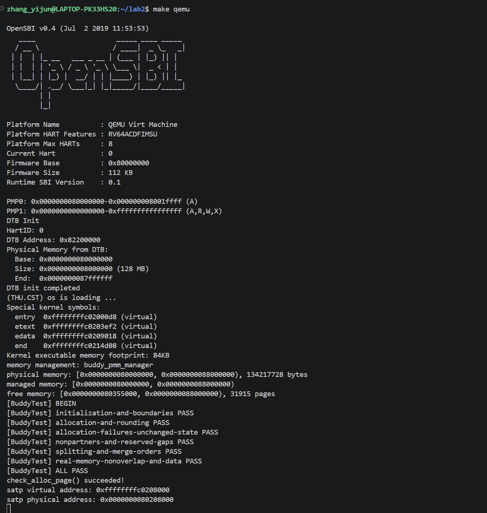
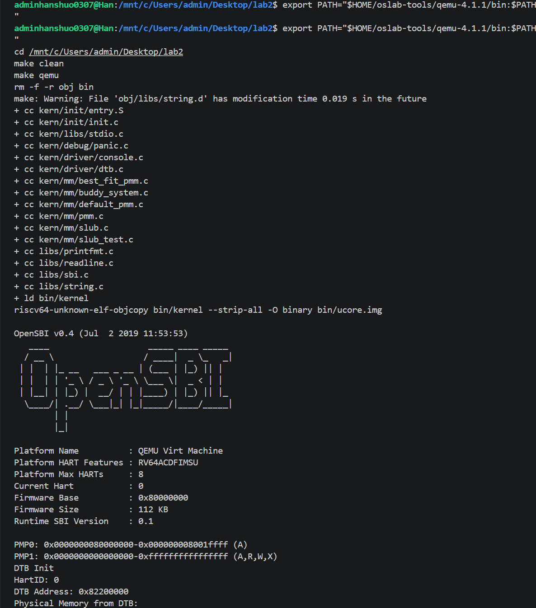
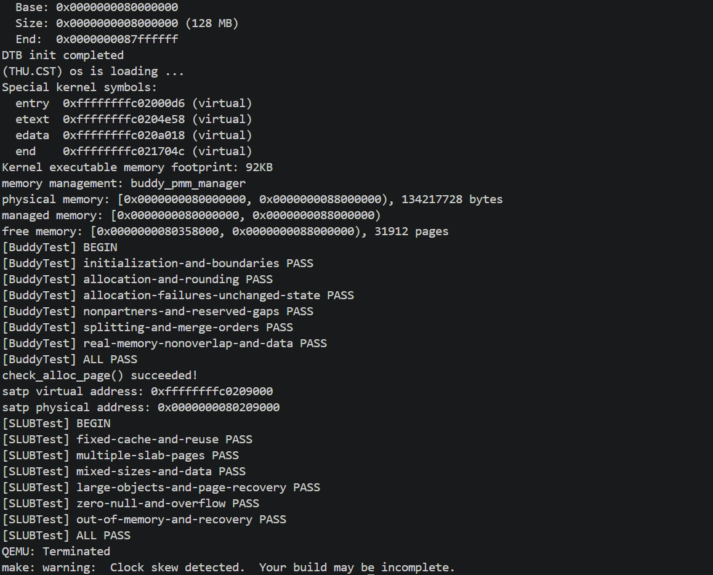

# 实验报告

## 实验基本信息

| 项目 | 内容 |
|------|------|
| **实验名称** | Lab 2: 物理内存和页表 |
| **小组成员** | 2512621-尹雯婕、2511461-张壹钧、2512752-韩硕 |
| **完成日期** | 2026-10-23 |

### 小组分工


| 成员 | 负责的练习/模块 |
|------|----------------|
| 2512621-尹雯婕 | 负责物理内存初始化、硬件内存范围获取方式分析、First Fit流程分析、Best Fit实现及对应测试验证 |
| 2511461-张壹钧 | 负责Buddy_System分配器的实现及对那个测试验证 |
| 2512752-韩硕 | 负责简化SLUB分配器的实现与内核接入，设计实现和测试提示词，编写测试并验证不同大小对象的分配、释放与内存回收 |


---

## 一、实验目的

<!-- 说明本次实验的主要目标和预期成果 -->

本实验的主要目的是：

1. 理解物理页描述符struct Page与物理页之间的对应关系
2. 掌握物理内存范围检查、保留区域处理、页面对齐和空闲页登记
3. 理解First Fit，完成Best Fit的分配、切分、释放和合并
4. 使用QEMU、GDB和评分脚本验证实现

---

## 二、实验环境

你们使用的 AI 工具

| 成员 | AI 编程工具 | 底层模型 | 备注 |
|------|------------|---------|------|
| 2512621-尹雯婕 | ChatGPT网页版 | GPT-6.1 | |
| 2511461-张壹钧 | Codex vscode插件| GPT-6.1 sol| 推理强度：高|
| 2512752-韩硕 |ChatGPT网页版 |GPT-6.1 sol | |

**说明：**
- **AI 编程工具**：指具体使用的终端工具、编辑器插件、桌面应用或浏览器界面
- **底层模型**：指该工具使用的大语言模型及版本

---

## 三、实验整体逻辑分析

### 3.1 本章节的逻辑主线

本实验围绕物理内存管理展开。内核首先获取物理内存的起始地址和大小，建立物理页描述符数组，并保留固件、内核及描述符数组占用的物理页。随后，将剩余完整物理页登记为空闲区域，由物理内存管理器完成后续的连续页分配和释放。

### 3.2 功能的逐步实现

1. 首先实现page_init()，确定可管理的物理内存范围，完成页描述符初始化和空闲页登记，为分配器提供可用物理页
2. 接着阅读default_pmm.c，理解First Fit如何通过空闲链表记录连续空闲块，以及如何完成块的切分和合并
3. 在此基础上实现Best Fit，将空闲块选择策略调整为选择满足申请的最小空闲块，并通过struct pmm_manager接入内核
4. 实现Buddy伙伴系统，按2的幂次管理连续物理页，通过拆分完成分配，通过伙伴合并回收页面
5. 在页分配的基础上实现简化SLUB，将页面划分为小对象，并提供按字节申请和释放内存的接口
6. 分阶段进行编译、调试、自检和评分验证，检查各模块接入后能否正常运行，并保存实际测试记录

---

## 四、实验内容与实现

<!-- 
说明：本部分按照 exercises 文档中的练习顺序组织
每个功能模块或者练习中可能包含多项任务，请根据实际情况调整
-->

### 4.1 功能模块：物理内存初始化

**负责人：** 2512621-尹雯婕

#### 模块功能描述

**需要实现/修改的函数：**

```c
// 列出本模块涉及的所有函数签名
static void page_init(void);
```

**功能说明：**

本模块负责将探测到的物理内存转换为内核可以管理的物理页集合，为后续物理页分配器提供空闲区域。

实现时，首先通过get_memory_base()和get_memory_size()获取物理内存信息，检查内存大小及地址范围是否有效。

随后设置va_pa_offset，结合探测结果和内核映射上限确定实际管理范围，并将范围末尾向下按页对齐。npage记录管理范围结束地址对应的物理页号。Page数组安排在内核结束地址之后，其起始地址向上按页对齐。写入数组前检查整个数组是否能够放入管理范围，避免初始化过程中越界。

初始化时，将所有管理范围内的物理页设置为保留状态。然后计算Page数组之后的第一个完整物理页，将其后的完整页通过init_memmap()登记为空闲页。这样，固件、内核、Page数组及对齐产生的间隙不会被错误分配。

#### 最终提示词

以下是经过迭代优化后，最终成功实现该功能的提示词：

````markdown

任务说明:  
请直接修改kern/mm/pmm.c，完成物理内存初始化，并说明修改和验证结果
上下文信息 : 
使用已有的get_memory_base()、get_memory_size()、PADDR()、pa2page()、init_memmap()；相关类型和宏以工程源码为准
接口清单 :
实现static void page_init(void)，正确设置va_pa_offset、npage、pages，保持其他接口不变
行为规格:  
检查内存信息并限制管理范围；在内核结束后安排Page数组；保留固件、内核和数组占用页；将剩余区域按整页对齐后登记为空闲区。信息无效时终止初始化，没有完整空闲页时不登记，输出探测到的内存范围

````
#### 实现迭代与验证过程

根据提示词完成`page_init()`后，重点检查内存范围限制、Page数组布局和保留页处理。实现中先初始化全部描述符的保留状态，再只登记剩余完整页，避免固件、内核或管理数据结构占用的页面进入空闲链表。

调试时，在`best_fit_check()`入口设置断点。程序到达该位置时，物理内存初始化已经完成，Best Fit自检尚未执行，因此可以检查初始化后的全局变量。


使用 GDB 读取`va_pa_offset`、`npage`、`pages`和空闲页总数，结果如下。


| 检查项目 | 实测结果 | 分析 |
| --- | --- | --- |
|`va_pa_offset`|`0xffffffff40000000`| 与工程使用的虚实地址偏移一致 |
|`npage`|`557056`，即`0x88000`| 对应管理范围结束地址`0x88000000`的物理页号上界 |
|`pages`|`0xffffffffc0207000`|Page数组起始地址满足4KB页对齐 |
|`nr_free`|`31929`| 与内核运行时输出的空闲页数一致 |

需要注意，`npage` 是物理页号上界，本次128MB物理内存共包含32768个4KB页面，扣除保留区域后登记了31929个空闲页

最终，物理内存初始化相关代码完成编译，并通过评分脚本中的`check page init`检查，评分截图见第五章

### 4.2 Challenge（选做）：硬件内存范围获取方式

**负责人：** 2512621-尹雯婕

**问题：** 操作系统如何获取硬件可用物理内存范围？

操作系统需要依据平台提供的硬件描述信息确定物理内存布局，再从中排除不能分配的区域。物理内存的起始地址和大小由启动阶段提供的信息确定。

本工程通过设备树获取内存信息。QEMU提供设备树，OpenSBI在进入内核时通过寄存器`a1`传入设备树的物理地址。启动汇编保存该地址，随后由`dtb_init()`解析内存节点的`reg`属性，取得物理内存起始地址和大小。

解析结果通过`get_memory_base()`和`get_memory_size()`提供给`page_init()`,后者结合内核映射范围限制实际管理上限，再保留固件、内核、Page数组和对齐间隙所占用的页面，最终将剩余完整页面交给分配器。

### 4.3 练习：First Fit 算法理解

**负责人：** 2512621-尹雯婕

#### 数据结构与初始化

阅读`default_pmm.c`可知，First Fit使用空闲链表记录连续空闲块。块首页通过`property`保存块长度，并设置`PageProperty`标志；`nr_free`记录空闲页总数。

`default_init()`初始化空闲链表并将空闲页数清零，`default_init_memmap()`初始化待登记区域的页描述符，在块首页记录长度，并按照地址顺序将空闲块插入链表

#### 分配与切分

`default_alloc_pages()`从链表头开始查找，选择第一个长度不少于申请页数的空闲块。如果没有满足条件的连续空闲块，则返回`NULL`，因此，空闲页总数足够并不一定意味着能够完成连续页分配

找到空闲块后，将其从链表移除。如果块长度大于申请量，则分配前面的页面，将剩余部分作为新的空闲块放回原位置，同时减少空闲页总数，并清除已分配块的空闲块首页标志

#### 释放与合并

`default_free_pages()`恢复待释放页面的状态，在释放块首页记录长度，并按地址将其插入空闲链表。随后检查其与前后空闲块是否物理连续，若连续则合并长度，并撤销被合并块的首页标志及链表节点。

这里的指针加法作用于Page数组，例如`prev + prev->property == base`表示前一个空闲块结束后紧接着本次释放块。Page数组中的连续描述符对应连续物理页，因此可以据此判断物理连续性。

#### 改进空间

First Fit实现简单，找到第一个满足条件的块即可结束查找，但最坏仍需要遍历整个空闲链表，时间复杂度为`O(k)`，其中`k`为空闲块数量。可以考虑增加辅助索引以提高查找效率。

此外，First Fit可能留下较多小空闲块。可以结合不同的申请与释放序列，比较其他分配策略的碎片情况；释放时及时合并相邻空闲块，则有助于恢复较大的连续空闲区域。

### 4.4 功能模块：Best Fit 分配器

**负责人：** 2512621-尹雯婕

#### 模块功能描述

**修改文件：** `kern/mm/best_fit_pmm.c`、`kern/mm/pmm.c`。

**涉及的主要函数：**

```c
static void best_fit_init(void);
static void best_fit_insert_block(struct Page *base);
static void best_fit_init_memmap(struct Page *base, size_t n);
static struct Page *best_fit_alloc_pages(size_t n);
static void best_fit_free_pages(struct Page *base, size_t n);
static size_t best_fit_nr_free_pages(void);
```

本模块定义`best_fit_pmm_manager`，绑定初始化、空闲区登记、分配、释放、空闲页数查询和自检接口，并在`pmm.c`中切换为该管理器。

空闲链表始终按照地址递增排列。分配时遍历空闲块，选择长度不少于申请量且长度最小的块。同样大小的块优先选择低地址块：由于链表按地址递增遍历，只有发现更小的合格块时才更新候选，因此同长度情况下保留先遇到的低地址块。找到与申请量恰好相等的块时，可以提前结束查找。

分配成功后，将选中块移出链表。若存在剩余页面，则建立新的空闲块并放回原位置，保持地址顺序，同时更新块首页标志和空闲页数。不存在满足条件的连续空闲块时返回`NULL`。

释放时，恢复页面状态，将释放区域按地址插入链表，再检查并合并连续的前后空闲块。合并时保留合并后块首页的标志，撤销被合并块的首页标志及链表节点。释放页数只计入空闲页总数一次，合并不重复增加计数。

#### 最终提示词

以下保留实际输入的任务提示词及末尾执行要求：

```markdown
任务说明：阅读pmm.h中的struct pmm_manager，修改kern/mm/best_fit_pmm.c，完成Best Fit分配器，并在kern/mm/pmm.c中切换为该管理器
上下文信息：参考default_pmm.c，使用工程已有的struct Page、struct pmm_manager和链表操作。现有测试直接使用free_list、nr_free，实现须兼容
接口清单：实现管理器的初始化、空闲区登记、分配、释放和空闲页数查询接口，定义best_fit_pmm_manager并绑定best_fit_check()。辅助函数使用static，不得修改两个原有测试函数。
行为规格：每次选择满足申请的最小空闲块，同大小时优先选择低地址块；正确切分剩余部分，失败返回NULL。空闲链表按地址排序，释放时合并连续的前后空闲块，正确维护首页标志和空闲页总数。
```

#### 实现迭代与验证过程

实现时保留`free_list`和`nr_free`，使管理器与原有测试兼容；将按地址插入及相邻块合并封装为静态辅助函数，供空闲区登记和释放调用。原有`basic_check()`与`best_fit_check()`测试函数保持不变，通过管理器的`check`接口执行自检。

在GDB中命中`best_fit_check()`后，使用`finish`执行完该函数，程序返回到`check_alloc_page()`中准备输出成功提示的位置。


该截图展示自检函数返回的位置；实际成功输出由第五章的QEMU运行截图证明。最终，Best Fit完成编译，通过原有自检及评分脚本中的`check best fit`检查。

#### 改进空间

当前实现查找最小合格空闲块的最坏时间复杂度仍为`O(k)`，可以增加按照块大小组织的辅助索引，同时保留地址关系以支持释放合并，但需要同步维护多种索引的一致性。

Best Fit虽然使单次分配后的剩余块尽可能小，但也可能产生难以利用的小碎片，不能保证在所有申请序列中都优于First Fit。不同策略的效果需要结合实际工作负载比较。

### 4.5 功能模块：Buddy_system 伙伴系统分配算法的实现
**负责人：** 2511461-张壹钧

#### 模块功能描述

**新增文件：** `kern/mm/buddy_system.c`、`kern/mm/buddy_system.h`。

**修改位置：** 在 `kern/mm/pmm.c` 中引入 `buddy_system.h`，并将 `init_pmm_manager()` 选择的管理器切换为 `buddy_pmm_manager`。原有 First Fit、Best Fit 分配器代码保留。`buddy_system.h` 声明管理器对象，具体算法、辅助函数及测试均放在 `buddy_system.c` 内部，辅助函数使用 `static` 限定作用域。

**涉及的主要函数：**

```c
static void buddy_init(void);
static void buddy_init_memmap(struct Page *base, size_t n);
static struct Page *buddy_alloc_pages(size_t n);
static void buddy_free_pages(struct Page *base, size_t n);
static size_t buddy_nr_free_pages(void);
static void buddy_check(void);
static void buddy_test_all(void);
```

本模块通过 `struct pmm_manager` 接入已有框架，调用关系为 `pmm_init()` → `init_pmm_manager()` → `page_init()` → 管理器的 `init_memmap()`。因此，伙伴分配器仅接收 `page_init()` 已确认可用的物理页区间，不会将整个描述符数组直接视为空闲内存。

**数据结构与状态约定：** 使用 `buddy_areas[BUDDY_MAX_ORDER + 1]` 按阶管理空闲块，第 `k` 阶管理大小为 `2^k` 页的块，最小单位是一页，即 4096 字节。每阶复用 `free_area_t`，其中 `free_list` 保存块首页的 `page_link`，`nr_free` 记录该阶空闲页数；`buddy_nr_free` 记录所有阶的空闲页总数。空闲链表使用尾插法，不要求按地址排序。

空闲块首页设置 `PG_property`，其 `property` 保存块页数；块内其他页面的 `property` 为 0。分配后清除首页的 `PG_property`，但保留实际分配块大小，用于释放时校验。因此，不能仅凭 `property` 非零判断页面空闲，也不能仅凭未设置 `PG_reserved` 判断页面空闲。

**初始化与区间登记：** `buddy_init()` 清空各阶链表和统计信息。`buddy_init_memmap()` 检查待登记区间及保留状态，初始化这些页面的描述符，再从当前起点逐次选择“大小不超过剩余页数、且物理页号满足对应对齐”的最大二次幂块，直至全部页面登记完成。登记过程中也会尝试合并已有空闲伙伴，因此多次交付的相邻可用区间可以在满足伙伴关系时共同形成大块。

**分配与拆分：** 将请求 `n` 向上取整为不小于 `n` 的最小二次幂，优先使用对应阶空闲块；该阶为空时向高阶查找。找到较大块后逐级对半拆分，继续拆分左半块，将右半块登记到对应低阶链表。最终只按实际分配块大小扣减全局空闲页数。例如申请 3 页实际占用 4 页，申请 9 页实际占用 16 页；没有足够大的块时返回 `NULL`。

**释放与合并：** 释放时仍可传入原始申请页数，由接口向上取整得到实际块大小，并检查其与块首页记录一致，只回收完整分配块。设块首页物理页号为 `ppn`，块大小为 `2^k` 页，则伙伴页号为 `ppn ^ (2^k)`。实现先检查伙伴页号及整个伙伴块是否位于 `[nbase, npage)` 内，再转换为描述符；只有伙伴未被保留、具有空闲首页标志且块大小相同，才移出链表并向上合并。合并后选择低地址作为新块首页，继续尝试更高阶合并。伙伴通过物理页号直接定位，合并判断不依赖链表是否有序。

释放按实际块大小增加一次全局空闲页数；拆分、合并仅重新组织各阶空闲块，不额外增加或减少空闲页面。

#### 最终提示词

任务提示词过长，已单独放入 [prompt.md](./prompt.md) 文件中，包含模块实现、补充测试及取消地址升序要求的后续修订，本节不重复填写提示词正文。

#### 实现迭代与验证过程

**1. 先完成实现与接入，再补充独立测试。** 初始阶段按照“先生成文件，暂不校验”的要求创建模块并接入管理器，保留 `buddy_check()`。之后新增静态入口 `buddy_test_all()`，由 `buddy_check()` 首先调用，再继续执行原有链表检查、混合大小分配及真实空闲页耗尽与归还检查。这样既覆盖人为构造的边界场景，也保留对实际管理内存的整体回归验证。

**2. 隔离测试环境与真实管理器。** `bt_run_isolated()` 使用静态数组 `bt_fake[160]` 提供模拟描述符，保存真实的 `pages`、`npage`、各阶链表表头和计数、全局空闲页数，再临时切换到模拟管理环境。真实描述符不参与模拟操作，`nbase`、管理器对象和虚实地址偏移不变。测试返回后恢复保存的状态；由测试检查报告的失败也先恢复状态，再由调用方触发断言。原有链表节点始终指向原表头地址，按原值恢复表头即可恢复其链接关系。模拟环境只检查描述符，不向对应的虚构物理地址写数据；实际读写另在恢复后的真实环境中进行。大型数组均使用静态存储，避免耗尽 8 KiB 启动栈。

**3. 使用独立期望值与逐页不变量，验证状态完整性。** 这里的“完整性”指可用页不丢失、不重复、不越界，保留页不被分配，链表、描述符及统计相互一致。测试用独立的 `bt_available` 记录已交付页面，用 `bt_taken` 记录当前实际分配区间，遍历空闲链表时再构造 `bt_seen`。对每个模拟页面检查：

```text
bt_seen[i] == (bt_available[i] && !bt_taken[i])
```

该逐页等式既要求所有应当空闲的页面都在链表中，也禁止保留页或已分配页进入空闲集合；遍历中发现同一页面再次出现便失败，因此还能检测重复节点、同阶或跨阶块重叠。相较于只检查“空闲总数正确”，它可以发现“漏登记若干页，同时又重复登记等量页面”这类计数恰好抵消的错误。

`bt_lists()` 同时检查节点地址合法、前后指针互相一致、块大小与所属阶一致、物理页号对齐、块范围不越界、首页及内部页状态正确，并核对“每阶块页数之和 = 该阶计数”“各阶计数之和 = 全局空闲页数”。每阶遍历次数不超过描述符总数，避免损坏链表导致无限遍历。分配、释放前后的计数按实际块页数核对，从而同时验证集合关系和页数守恒。

**4. 通过正向、反向和恢复路径，验证功能覆盖的完备性。** 这里的“完备性”指针对本任务规格，初始化、分配、取整、拆分、释放、合并、失败及恢复均有相应测试，而不是声称枚举了所有输入或完成了形式化证明。各组测试及判断依据如下。

| 测试组 | 构造及检查内容 | 能验证的性质 |
| --- | --- | --- |
| `initialization-and-boundaries` | 在按物理页号对齐的参考起点上登记偏移 `[1,15)`、`[33,54)`，长度分别为 14、21 页，中间保留 `[15,33)`；独立列出预期块起点与大小，并逐页分配全部 35 页，确认第 36 次失败，最后全部归还 | 同时覆盖非二次幂长度、不满足高阶对齐的起点、保留间隔及尾部余页。预期块表验证最大合法块划分，逐页核对与耗尽验证没有遗漏、重复或误分配保留页 |
| `allocation-and-rounding` | 在已知 64 页块中同时申请 `1、2、4、8、3、5、9` 页，独立写出期望占用 `1、2、4、8、4、8、16` 页；检查返回区间、对齐、状态和计数，再用原始请求页数释放 | 资源足够时必须成功，不能以跳过失败申请获得通过；期望值不调用被测取整函数，避免测试与实现共享同一计算错误；释放计数恢复验证归还的是完整实际块 |
| `allocation-failures-unchanged-state` | 测试超过最大支持块及极大请求；耗尽 8 页后申请 1 页；仅释放四个两页块中的第 0、2 块，使总空闲数为 4，再申请 3 页；每次失败前后逐字节比较所有模拟描述符、各阶表头与计数，并核对全局计数 | 分别覆盖请求范围检查、真正耗尽、总数足够但无足够大伙伴块的失败；快照比较证明失败不仅返回 `NULL`，也未改变原有链表和描述符状态 |
| `nonpartners-and-reserved-gaps` | 构造相邻同阶但非伙伴的 `[4,8)`、`[8,12)`；另构造被保留区隔开的 `[0,4)`、`[8,12)`。分别分配、释放后，确认申请 8 页仍失败 | 反向验证合并条件，防止把“物理相邻”误当成“伙伴”，或跨过保留区域拼出不存在的大块 |
| `splitting-and-merge-orders` | 从已知 16 页块申请 1 页，检查偏移 `1、2、4、8` 处分别登记 `1、2、4、8` 页的剩余块，共 15 页；释放后恢复 16 页。随后将四个四页子块分别按 `0、2、1、3` 和 `3、1、2、0` 顺序归还，两次均重新申请到原起点的完整 16 页块 | 精确检查每级拆分余块的链表位置和大小；仅一个子块释放时仍保持四页块，避免与尚未释放的伙伴合并；不同顺序最终均可重新取得大块，验证逐级合并与连续分配能力恢复 |
| `real-memory-nonoverlap-and-data` | 在真实管理器中同时保留上述七种请求，按实际块长度两两检查区间不相交；通过 `page2pa() + va_pa_offset` 转换并检查内核映射范围，对全部实际占用字节写入与块编号和偏移有关的模式，所有写入完成后再统一读回核对，随后归还页面并再次申请一页 | 描述符区间检查验证分配不重叠，延迟读回验证真实物理页面不存在重复分配或相互覆盖；归还后计数恢复且仍能分配，验证测试没有耗尽或损坏真实管理器 |

原有 `buddy_check_lists()` 还检查不存在可继续合并的同阶空闲伙伴。原有 `buddy_check()` 随后将真实空闲内存逐页分配至耗尽，用分配页数核对初始空闲页数，再逆序归还，并比较最终总数及各阶页数与初始值是否一致。这使验证范围从 160 个模拟描述符扩展到本次启动交付的全部真实空闲页，也检查了反复拆分、合并后管理能力是否恢复。

因此，完整性由逐页覆盖、唯一性、状态合法性、实际数据保持和计数守恒共同验证；功能覆盖的完备性由成功与失败、正确合并与禁止合并、分配与完整归还、模拟边界与真实内存的对应测试支撑。两者相互补充，不能仅凭某一次申请成功或最后总数相同得出结论。

**5. 记录首次失败并修订测试契约。** 最初的测试额外要求同阶链表按地址升序排列。在高地址子块先释放的场景中，四页块按偏移 `12、4` 的顺序尾插，链表成为 `[12,4]`，因此触发顺序断言。该次运行仅前四组通过，后续真实内存测试尚未执行，也没有打印 `ALL PASS`。

后续明确要求“不保证地址升序，保留尾插方法”，因此仅移除 `bt_lists()` 的地址升序比较及其辅助变量，保留双向指针、节点唯一性、范围、对齐、状态、覆盖关系与统计检查，未改动分配和合并算法。伙伴由物理页号异或直接查找，尾插产生的链表顺序不影响伙伴判定；逐页位图检查也不依赖遍历顺序，因此取消排序要求不会取消对重复、重叠或页面遗漏的检查。

**6. 实际运行结果。** 调整测试要求后实际执行：

```bash
make -j2
timeout 12s make qemu > /tmp/buddy-test-work/qemu.log 2>&1
```

编译、链接及 `bin/ucore.img` 生成成功。此次 Buddy 验证使用现有 Makefile 的 `make qemu` 目标，通过 `-device loader,file=bin/ucore.img,addr=0x80200000` 加载内核；与前文 Best Fit 记录中的启动命令分别对应各自验证过程。

日志显示管理器为 `buddy_pmm_manager`，QEMU 提供 128 MiB 物理内存，本次实际空闲区为 `[0x80355000, 0x88000000)`，共 31915 页。该数值对应加入 Buddy 模块及静态测试数组后的内核布局，与前文 Best Fit 阶段的 31929 页记录属于不同构建，不能直接视为页面丢失。实际运行结果见图4-4。



`ALL PASS` 表明六组新增必测项目全部执行成功，之后的 `check_alloc_page() succeeded!` 表明保留的原有 `buddy_check()` 检查也已完成。内核随后进入正常等待循环，QEMU 由 `timeout` 结束，命令退出码为 124，不能据此将已完成的自检判为失败。

本次结果验证了当前单核运行环境及上述构造场景下的状态完整性与任务功能覆盖。申请 0 页会触发断言，按要求未纳入默认测试；部分释放、重复释放等非法调用的断言路径未独立运行，也未穷举所有阶数、所有申请释放排列或并发情形。这些未执行项目不计入已通过结论；本模块验证也不借用前文 Best Fit 的评分成绩作为 Buddy 测试结果。


### 4.6 Challenge（选做）：简化SLUB内存分配器

**负责人：** 2512752-韩硕

#### 模块功能描述

**新增文件：** `kern/mm/slub.h`、`kern/mm/slub.c`、`kern/mm/slub_test.h`、`kern/mm/slub_test.c`。

**修改位置：** 在`kern/init/init.c`中引入SLUB及测试头文件，在`pmm_init()`之后依次调用`slub_init()`和`slub_check()`。

**涉及的主要函数：**

```c
bool kmem_cache_init(struct kmem_cache *cache, size_t size);
void *kmem_cache_alloc(struct kmem_cache *cache);
void kmem_cache_free(struct kmem_cache *cache, void *ptr);
void slub_init(void);
void *kmalloc(size_t size);
void kfree(void *ptr);
void slub_check(void);
```

本模块在Buddy页分配器基础上实现简化SLUB。Buddy负责分配整页，SLUB将页面划分为小对象，并通过`kmalloc()`和`kfree()`提供按字节申请和释放内存的接口。

小对象根据申请大小选择合适的缓存，缓存不足时申请新页；大于2048字节的对象直接使用连续页。释放的小对象可以再次使用，页面中的对象全部释放后，将该页归还Buddy。

#### 最终提示词

**1. 实现提示词**

```text
任务说明：
请直接修改真实工程文件，实现一个简化SLUB内存分配模块。新增kern/mm/slub.h、kern/mm/slub.c，并在kern/init/init.c的pmm_init()之后接入初始化。实现固定大小对象缓存和按字节申请的内存分配，不修改已有物理内存初始化、Buddy、Best Fit及其测试，不修改启动汇编和Makefile。
上下文信息：
使用工程已有的alloc_pages(size_t n)、free_pages(struct Page *base, size_t n)、nr_free_pages()和页地址转换接口。页面大小为4096字节，alloc_pages()返回Page描述符，page2pa(page) + va_pa_offset得到对应内核虚拟地址。当前底层为Buddy，请求页数会向上取整到2的幂，释放时支持传入原始请求页数。Page.property由Buddy管理，SLUB不能覆盖。类型、宏和辅助函数以真实工程定义为准。
接口清单：
实现kmem_cache_init()、kmem_cache_alloc()、kmem_cache_free()、slub_init()、kmalloc()和kfree()，声明与实现保持一致。辅助函数使用static。保留现有PMM公开接口，在pmm_init()之后初始化SLUB。
行为规格：
固定大小缓存支持1～2048字节，对象地址按16字节对齐。分配成功时返回足够大小、可写且与其他活对象不重叠的空间，无法满足时返回NULL。释放的对象能够再次使用，整页全部空闲时归还底层。kmalloc()支持不同大小申请，小对象使用合适的缓存，大对象使用连续页；零字节申请、大小计算溢出或内存不足时返回NULL。kfree(NULL)不改变状态，大对象释放后完整归还底层分配块。一组对象全部释放后，空闲页数应恢复。调用者只释放有效且尚未释放的对象起始地址，不要求实现复杂并发机制。
```

**2. 测试提示词**

```text
任务说明：
请直接在真实工程中新增kern/mm/slub_test.h和kern/mm/slub_test.c，编写SLUB内核测试，并在pmm_init()、slub_init()之后调用。测试应覆盖申请、读写、释放、复用和失败后恢复的完整过程，保留已有分配器及其原有测试。
上下文信息：
使用slub.h中的固定大小缓存接口和kmalloc()/kfree()，通过nr_free_pages()检查页面回收，通过assert()检查结果，通过cprintf()输出测试状态。当前小对象类别为16～2048字节，大对象使用连续页，底层Buddy会对请求页数取整。启动栈只有8KiB，大型测试数组应使用静态存储。测试不能破坏Buddy保留在Page.property中的信息。
接口清单：
在slub_test.h中声明void slub_check(void)，在slub_test.c中实现该函数。各组辅助测试函数使用static，不改变SLUB公开接口。
行为规格：
测试固定大小对象的分配、释放和复用；大量对象申请时扩展到多页；不同大小及类别边界的对象能够同时使用，地址不重叠，所有写入完成后数据仍正确；大对象反复分配和释放后页数恢复；零字节、NULL释放和极大申请符合接口约定；底层页耗尽时，需要新页的申请返回NULL，已有缓存仍可提供剩余对象，归还全部资源后可以继续分配。每组测试结束后核对空闲页数，全部检查通过才输出ALL PASS，并说明每组测试为什么有效。
```

#### 实现迭代与验证过程

首先完成固定大小缓存和`kmalloc()`、`kfree()`接口，再将初始化与测试接入内核。SLUB复用已有的页分配接口，保持Buddy的管理器选择和原有自检不变。

随后编写六组测试。测试不只检查返回值，还向申请到的空间写入数据，在其他对象写入完成后再统一读取，检查对象之间是否发生覆盖。每组测试全部释放后，比较`nr_free_pages()`与测试前的数值，检查页面是否完整归还。

| 测试组 | 检查内容 | 验证作用 |
| --- | --- | --- |
| `fixed-cache-and-reuse` | 申请多个64字节对象，释放其中一个后再次申请，并检查其他对象的数据 | 检查固定大小分配、空闲对象复用和数据保持 |
| `multiple-slab-pages` | 申请600个16字节对象，检查地址及数据，交错释放 | 检查缓存扩展到多页，以及空页能否归还 |
| `mixed-sizes-and-data` | 同时申请多种大小，覆盖类别边界及多页对象，全部写入后再读取 | 检查大小选择、地址对齐、空间不重叠及数据正确性 |
| `large-objects-and-page-recovery` | 反复申请和释放8192字节对象 | 检查连续页申请、Buddy页数取整和完整回收 |
| `zero-null-and-overflow` | 检查非法缓存大小、零字节、NULL释放和极大申请 | 检查约定的边界行为和溢出处理 |
| `out-of-memory-and-recovery` | 暂时取走底层剩余页，检查申请失败、已有小块继续使用及归还后恢复 | 检查内存不足时的行为及后续分配能力 |

本次在QEMU 4.1.1环境中执行`make clean`和`make qemu`，新增源文件完成编译和链接。运行时，原有Buddy测试先通过，随后六组SLUB测试全部输出`PASS`，最后输出`[SLUBTest] ALL PASS`。





上述结果说明，本实现通过了当前单核环境下设计的测试。测试没有覆盖并发访问，也没有将重复释放、任意非法指针释放等错误调用计入已通过范围。

---
## 五、测试与验证
### 5.1 编译验证
在 WSL 的项目目录中执行

```bash
make
```
编译过程完成源文件编译和内核链接，随后通过`riscv64-unknown-elf-objcopy`生成`bin/ucore.img`。记录中出现文件时间戳警告，但编译和镜像生成完成。


### 5.2 内核运行与自检

本次实际使用以下命令启动内核：

```bash
qemu-system-riscv64 -machine virt -nographic -bios default -kernel bin/ucore.img
```

内核输出的空闲物理内存区域为 `[0x80347000, 0x88000000)`，空闲页数为31929，与GDB读取结果一致。随后输出：

```text
check_alloc_page() succeeded!
```

说明当前管理器的原有分配自检执行通过。


自检之后内核进入`kern_init()`末尾的`while (1)`，不会自动退出。该循环属于当前内核的正常结束状态，不能仅因其不再输出而判断自检失败。

### 5.3 自动评分

为适配当前环境，将`tools/grade.sh`中的内核加载参数调整为`-kernel bin/ucore.img`，评分检查内容保持不变。评分启动参数为：

```sh
qemuopts="-machine virt -nographic -bios default -kernel bin/ucore.img"
```

在 WSL 的项目目录中执行：

```bash
make grade
```

实际评分结果为：

```text
-check page init: OK
-check best fit:  OK
Total Score: 20/20
```


### 5.4 调试与环境适配记录

初次启动时，OpenSBI输出的下一阶段入口地址为0，程序未进入预期的内核入口。将启动方式改为使用`-kernel bin/ucore.img`后，内核能够运行并完成自检。

GDB调试期间，内核高虚拟地址在分页建立前不可访问，直接设置断点出现内存访问失败。结合当前GDB的RISC-V断点行为，关闭压缩断点长度的自动判断，并使用一次性硬件断点完成调试。成功调试时使用的设置为：

```gdb
set riscv use-compressed-breakpoints off
monitor system_reset
thbreak *best_fit_check
continue
```

这些调整用于解决启动和调试环境问题，不作为分配算法的功能修改。调试变量检查、原有自检和自动评分分别提供了不同层面的验证依据。

### 5.5 SLUB编译与运行验证

在QEMU 4.1.1环境下执行：

```bash
make clean
make qemu
```

新增的SLUB模块完成编译和链接。运行时，Buddy原有自检通过，随后SLUB的六组测试全部通过，最终输出：

```text
[SLUBTest] ALL PASS
```

测试覆盖固定大小对象复用、多页扩展、不同大小对象的数据保持、大对象回收及边界情况，并通过比较释放前后的空闲页数检查页面回收。实际运行结果见图4-5。

## 六、实验总结与收获

### 6.1 对操作系统的理解

#### 本实验涉及的重要知识点及其与操作系统原理的关系

1. **物理页与管理数据结构。**`struct Page`保存物理页的管理信息，Page数组中的连续描述符对应连续物理页。描述符本身也占用物理内存，因此必须先安排并保留其存储区域，才能管理剩余页面。

2. **内存布局与保留区域。** 操作系统原理中的可用内存需要在实现中转化为明确的地址范围。本实验需要从探测到的RAM中排除固件、内核和Page数组，并通过页面对齐保证分配单位完整。

3. **连续内存分配与外部碎片。** First Fit和Best Fit的主要区别在于空闲块选择策略。即使空闲页总数足够，也可能因为没有足够大的连续空闲块而分配失败。及时合并相邻空闲块有助于恢复较大的连续区域。

4. **地址转换。** 虚拟地址、物理地址和物理页号具有不同含义。`va_pa_offset`用于工程中的地址转换，`npage`表示管理页号上界，不能直接作为空闲页数使用。

5. **页分配与小对象分配。** Buddy按整页管理内存，而SLUB在已分配页面内继续划分小对象。两者分别解决不同大小的内存申请问题。小对象释放后可以复用，页面完全空闲后再归还底层。这让我理解了内存管理可以分层完成，上层分配器也需要遵守底层的申请和释放规则。

### 6.2 AI 协作开发的经验

使用AI辅助实现时，需要明确工程已有接口、数据结构、边界条件及不能修改的测试函数。提示词中明确内存范围检查、页面对齐、同大小块的选择规则和测试兼容性，有助于减少实现与工程约束不一致的问题。

生成代码后，仍需要阅读关键逻辑，并通过实际编译、GDB变量检查、内核自检和评分脚本验证，不能仅根据AI的文字说明判断正确性。报告中的结论也应与实际截图对应，不将预期输出写成已经发生的结果。

本次排查表明，需要区分算法实现问题、QEMU启动参数问题和GDB调试设置问题。调试说明应注明命令执行位置、预期现象和停止条件，避免将主动暂停或内核末尾循环误判为异常。

保留原始提示词、实际运行命令和真实测试截图，能够使实现过程与验证结论相互对应，也便于向同伴交接后续实验。

